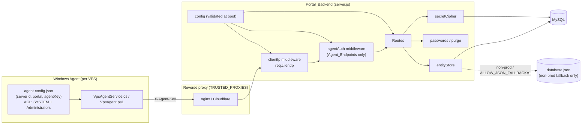
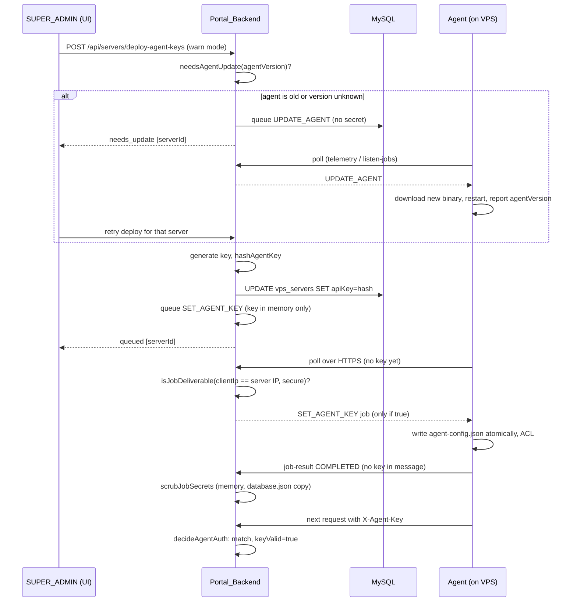
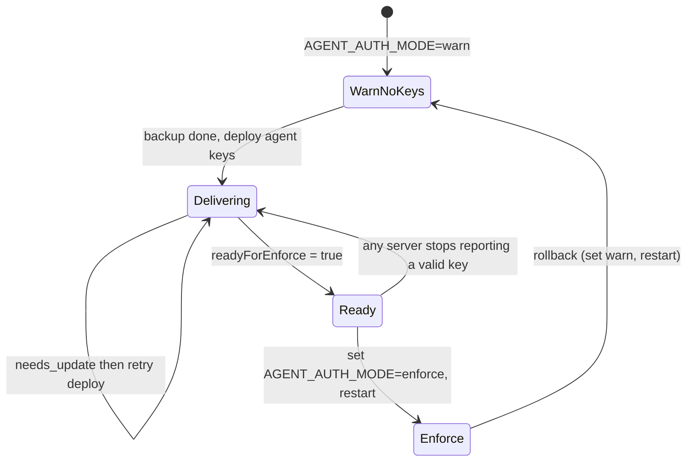

# Design Document: Production Hardening

## Overview

This design hardens the VPS management portal for production in six ordered phases (agent authentication, secrets, data storage, infrastructure, tests, operations). It adds a small set of focused modules under `lib/` and wires them into `server.js` with minimal edits. Existing API response shapes are preserved (Requirement 24.4).

Design principles:

- Put logic in pure, injectable modules (`lib/*.js`) so it can be property-tested without MySQL, the network, or a running server. `server.js` stays an integration layer.
- Make behavior explicit and fail closed in production, and keep today's behavior outside production.
- Keep each task to 5 or fewer files (Requirement 24.2). Module boundaries below follow that.

### What the code review of the repo confirmed

These findings come from reading the code and shape the design:

| Finding | Location | Design consequence |
|---|---|---|
| `app.set('trust proxy', 1)`; client IP computed inline in at least 8 places from `cf-connecting-ip` / `x-forwarded-for` / `x-real-ip` | `server.js` ~141, 1601, 1711, 2864, 3585, 6520, 6538, 6854 | One `clientIp` module and one middleware setting `req.clientIp`; inline expressions replaced |
| Agent endpoints identify callers by `serverId` (body/query/`x-server-id`), by IP, or by `migrationId`; `detect-server` has no serverId at all | `server.js` 2857, 3581, 3693, 4428, 4539, 4719, 6092, 6188, 6519 | `resolveAgentServer(req)` per-endpoint rule table (see Agent Auth) |
| `vps_servers.apiKey VARCHAR(100)` exists but is unused | `schema.sql`, `server.js` ~904 | Reuse column for the key hash, widen to `VARCHAR(255)` |
| `checkRateLimit` is `async`, but the forgot-password route reads `rateCheck.allowed` without `await`. `Promise.allowed` is `undefined`, so `!rateCheck.allowed` is always true and the route always answers 429 | `server.js` ~8761 | Fix is `await`; also adds a regression test |
| `INTERNAL_SECRET` has a hardcoded fallback and grants `SUPER_ADMIN` | `validateSession` ~1107 | Env-only, disabled when unset |
| `'Pass#123'` appears in schema, `initMySQLDatabase`, migration relay, bulk import, export, and password-change route | `server.js` 670, 3738, 4153, 4230, 4253, 7180, 7272, 7313, 7377; `schema.sql` 43 | Random-password generator; exports omit passwords by default (section 24) |
| Portal hostname hardcoded in CORS check, migration `uploadUrl`/`downloadUrl`, installer/telemetry URLs; `Host` / `x-forwarded-host` used to build installer URLs | `server.js` 162-164, 2410, 3745, 4181, 4260, 6553, 6798, 6866 | `PORTAL_BASE_URL` in one `config` object |
| `requests`, `renewals`, `migrations`, `deletedServers` live only in `memoryStore` and `database.json`. `deletedServers` is an array of lowercase **tombstone strings** (server id, `ip:port`, bare IP, name), not records | `server.js` 325-410, 2483-2498, 2867, 3587, 4169-4283 | Tombstone table keyed by the string, plus a snapshot column |
| Provision job passwords are inserted in plaintext and never purged; status updates only change `status`/`resultMessage` | `server.js` 2763, 2841, 3825 | Encrypt on insert, purge in the same statement that records the terminal status |
| Server starts with `app.listen(PORT, '0.0.0.0')` and logs "Bound to 0.0.0.0". The `TEST_MODE` guard around `listen` already exists and `app` is already exported | `server.js` 8917-8925 | Keep the guard, add `HOST`, startup checks |
| `/api/ai/translate` calls the unofficial `clients5.google.com` endpoint server-side. `src/utils/nlpTranslate.js` also calls `clients5.google.com` and `api.mymemory.translated.net` directly from the browser | `server.js` 8613+, `src/utils/nlpTranslate.js` | Both server and client fallbacks must go; the client calls only the backend route |
| `xlsx` is used in the browser by `BulkSharedVpsImportModal.jsx` (`XLSX.read`, `sheet_to_json`, `SSF.parse_date_code`) | `src/components/BulkSharedVpsImportModal.jsx` | Upgrade must keep that API surface |
| Agent config is `agent-config.json` under `%ProgramData%\InnovationWebWorks\VpsAgent`; the C# service sends `serverId` / `serverToken` in JSON bodies and `X-Server-Token` / `X-Server-Id` on long-poll; all HTTP goes through `TimeoutWebClient` or an `HttpWebRequest` in the listen loop | `public/VpsAgentService.cs` 30-36, 276, 313, 396-408 | Add `X-Agent-Key` in `TimeoutWebClient` and in the listen request |
| `install.ps1` calls `detect-server` before any key exists, then installs the service with `-serverId` and `-portal` | `install.ps1` 32-47, 145 | Bootstrap path must carry a key (see Agent Auth, Open Issue 1) |
| `scripts/build_encrypted_scripts.js` gzips and AES-256-CBC-encrypts the `*.master.ps1` files into self-decrypting wrappers | `scripts/build_encrypted_scripts.js` | Key-reading code goes into the master scripts; the build script itself needs no change beyond a verification step |
| `/uploads` is served by an unauthenticated `express.static` and includes `uploads/migrations/<id>.zip` | `server.js` 175, 4216-4742 | Authenticate voice notes, do not serve migrations (section 18, Open Issue 8) |
| `getServerAliases` matches by name and by bare-IP prefix | `server.js` 419-438 | Strict `findServerForKeyCheck` for auth (Property 35, Open Issue 9) |
| Two module-level `setInterval` calls; startup init runs inside the `listen` callback | `server.js` 205, 1460, 8920 | `unref()` plus `bootstrap()` (section 18, Open Issue 10) |
| `dev:all` is `node server.js`; `xlsx@^0.18.5`; no test runner | `package.json` | Add `concurrently`, `vitest`, `supertest`, `fast-check` (exact versions) |
| `serverToken` is sent by the agents but the backend only destructures it (`server.js` 6190) and never validates it; `X-Server-Id` is read as an identification hint (3583) | `server.js` 6190, 3583; `public/VpsAgentService.cs` | Retired as an auth concept: ignored by the backend, never authenticates (section 23.4, Property 36) |
| `loadDiskDatabase()` runs at module load (`let memoryStore = loadDiskDatabase();`, line 417); `saveDiskDatabase()` (line 388) rewrites `database.json` with passwords, 2FA data, and sessions in plaintext | `server.js` 325, 388, 417 | Disk persistence guard (section 20.1) |
| The migration relay, rollback, and reset run `UPDATE \`clients\`` (lines 3782, 4325, 4391); the table is `client_subscriptions`, and `.catch(() => {})` hides the failure | `server.js` 3782, 4325, 4391 | Fixed in section 20.4 |
| `vps_servers` has no column for runtime attributes (hardware drift baseline `lastHardware`, `physicalDisks`, ...); `requests`-style leads (`workspaceRequests`) have no table | `server.js` 1546-1567, 3152-3285; `schema.sql` | `vps_servers.meta` and `workspace_requests` (section 20.2) |
| Session cookie `secure` flag is derived from the spoofable `x-forwarded-proto` header; clear calls use different options; no `maxAge` | `server.js` 1522, 1942, 2020 | `lib/sessionCookie.js` (section 23.2) |
| TOTP secrets (`two_factor_secret`, `two_factor_temp_secret`, `VARCHAR(128)`) and backup codes are stored in plaintext | `server.js` 1670-1920; `schema.sql` 77-78 | Section 21 |
| `queueServerJob` copies request fields into jobs that the agent runs as administrator; only `sanitizeWindowsUsername` (line 488) validates | `server.js` 488, 2697 | `lib/jobParams.js` (section 22) |
| Public endpoints (`request-demo`, `verify-customer`, `public/tickets`, `reset-password`, `2fa/validate-login`) have no or weak rate limits; `otpVerify` store exists but is unused | `server.js` 199-201, 1546, 1699, 8236, 8288, 8844 | Section 23.1 |

## Architecture



### Module layout

New files (all ESM, matching `"type": "module"`):

| File | Purpose | Pure? |
|---|---|---|
| `lib/config.js` | Parse and validate environment into a frozen config; throws `ConfigError` listing every problem | Yes (takes `env` object) |
| `lib/clientIp.js` | `parseTrustedProxies`, `normalizeIp`, `deriveClientIp` | Yes |
| `lib/agentAuth.js` | `generateAgentKey`, `hashAgentKey`, `verifyAgentKey`, `decideAgentAuth`, Express middleware factory | Core is pure |
| `lib/secretCipher.js` | AES-256-GCM `encrypt` / `decrypt` / `isCiphertext` / `parseKey` | Yes |
| `lib/passwords.js` | `generatePassword`, `isDefaultPassword`, redaction helpers | Yes |
| `lib/entityStore.js` | Repository for requests, renewals, migrations, deleted servers (MySQL impl, in-memory impl for tests, JSON impl for non-prod) and the startup import | Logic is testable with the in-memory impl |
| `lib/translate.js` | Official Cloud Translation client with timeout and result normalization | Logic pure with injected `fetch` |
| `lib/agentKeyDelivery.js` | `buildSetAgentKeyJob`, `scrubJobSecrets`, `isJobDeliverable`, `needsAgentUpdate` (section 19) | Yes |
| `lib/agentKeyReadiness.js` | `evaluateReadiness` for `readyForEnforce` (section 19) | Yes |
| `lib/jobParams.js` | `validateJobParams`, `JobParamError`, `validateJobRequest` middleware (section 22) | Yes |
| `lib/totpSecrets.js` | `sealTotpSecret`, `openTotpSecret`, `hashBackupCodes`, `consumeBackupCode` (section 21) | Yes (bcrypt injected or imported) |
| `lib/publicProjections.js` | `toPublicClient`, `toPublicServer`, `toPublicJob`, `toPublicMigration`, `toPublicEmployee` | Yes |
| `lib/provisionJobs.js` | `finishJob`, `sweepTerminalJobs` (section 7) | Core with injected db and timer |
| `lib/diskPersistence.js` | Production guard for `database.json` (section 20.1) | Core with injected `fsImpl` |
| `lib/serverMeta.js` | `pickMeta`, `applyMeta`, `metaChanged` for `vps_servers.meta` (section 20.2) | Yes |
| `lib/dbWrite.js` | `safeWrite` replacing swallowed `.catch(() => {})` writes (section 20.5) | Yes |
| `lib/rateLimit.js` | `applyRateLimit`, `rateLimitKey` (section 14, 23.1) | Core with injected limiter |
| `lib/sessionCookie.js` | `sessionCookieOptions`, `sessionClearOptions` (section 23.2) | Yes |
| `lib/health.js` | `/health` handler factory | Core with injected db and timer |
| `scripts/migrate_passwords.js` | One-time Migration_Script | Core `migrateRecords()` pure |
| `scripts/backup_mysql.sh` | Backup_Script (Phase 1) | No |
| `docs/AGENT_KEY_ROLLOUT.md` | Agent key delivery and `enforce` gate procedure | No |
| `ecosystem.config.cjs`, `RUNBOOK.md`, `.env.example`, `README.md` (key backup section) | Ops artifacts | No |

`server.js` keeps routes and wiring. It gains: config load at the top, `app.use(clientIpMiddleware)`, `app.use('/api/agent', agentAuthMiddleware)`, and replacements at each hardcoded site.

### Phase and task mapping

| Phase | Requirements | Main files |
|---|---|---|
| 1. Agent auth (tasks 1 to 11) | 1, 2, 3, 4, 5, 20 (backup) | `lib/clientIp.js`, `lib/agentAuth.js`, `lib/agentKeyDelivery.js`, `lib/agentKeyReadiness.js`, `server.js`, `schema.sql`, `install.ps1`, `*.master.ps1`, `VpsAgentService.cs`, `AgentKeyPanel.jsx`, `AgentKeyRolloutPanel.jsx`, `docs/AGENT_KEY_ROLLOUT.md`, `scripts/backup_mysql.sh` (task 10, so a backup exists before any Phase 2 data change) |
| 2. Secrets (tasks 12 to 21) | 6, 7, 8, 9 | `lib/secretCipher.js`, `lib/passwords.js`, `lib/jobParams.js`, `lib/totpSecrets.js`, `lib/publicProjections.js`, `lib/provisionJobs.js`, `lib/config.js`, `scripts/migrate_passwords.js`, `schema.sql`, `server.js`, `.env.example`, `README.md` |
| 3. Data storage (tasks 22 to 26) | 10, 11 | `lib/entityStore.js`, `lib/diskPersistence.js`, `lib/serverMeta.js`, `lib/dbWrite.js`, `schema.sql`, `server.js` |
| 4. Infrastructure (tasks 27 to 34) | 12, 13, 14, 15, 16, 17 | `lib/config.js`, `lib/rateLimit.js`, `lib/sessionCookie.js`, `lib/translate.js`, `server.js`, `package.json`, `src/utils/nlpTranslate.js`, `src/components/BulkSharedVpsImportModal.jsx` |
| 5. Tests (tasks 35 to 37) | 18, 19 | `vitest.config.js`, `tests/**` |
| 6. Operations (tasks 38 to 43) | 21, 22, 23 (20 only referenced) | `lib/health.js`, `ecosystem.config.cjs`, `RUNBOOK.md`, `/health` route; Phase 6 only references the backup script from Phase 1 |

| 7. Follow-up fixes (tasks 44 to 53) | 26, 27, 28, 29, 34, 35 | server.js, lib/*.js, 	ests/**, RUNBOOK.md |
| 8. Grace window, proxy IP, startup log, real MySQL check (tasks 54 to 58) | 2.10 to 2.17, 3.9, 3.10, 12.6, 23.5, 37 | lib/agentAuth.js, schema.sql, server.js, public/api_proxy.php, scripts/test_real_mysql.js, EditServerModal.jsx, RUNBOOK.md |

The former hardening-addition items now have formal requirement IDs (Requirements 25 to 37), listed in "Requirement additions" after the Open Issues.

Phase 5 tests for earlier phases are written alongside the earlier phases where practical; Phase 5 adds the harness hardening (Requirement 18) and the cross-cutting suite. The task breakdown lives in `tasks.md`.

## Components and Interfaces

### 1. Configuration (`lib/config.js`)

```js
// Returns a frozen object, or throws ConfigError { problems: string[] }.
export function loadConfig(env = process.env, { listenPort } = {}): Config

type Config = {
  nodeEnv: string, isProduction: boolean,
  host: string,                       // HOST || '127.0.0.1'
  port: number,
  portalBaseUrl: string,              // trailing '/' stripped
  corsAllowedOrigins: string[],       // origin(portalBaseUrl) + CORS_ALLOWED_ORIGINS entries
  trustedProxies: string[],           // validated entries; default ['127.0.0.1','::1']
  agentAuthMode: 'warn' | 'enforce',
  encryptionKey: Buffer | null,       // 32 bytes; required in production
  internalSecret: string | null,      // null => internal secret path disabled
  allowJsonFallback: boolean,         // true only if ALLOW_JSON_FALLBACK === '1' in prod; always true outside prod
  diskPersistenceEnabled: boolean,    // derived: !isProduction || allowJsonFallback (section 20.1)
  warnings: string[],                 // e.g. "ALLOW_JSON_FALLBACK ignored"
  translate: { enabled: boolean, apiKey: string | null },
  rateLimits: { [name: string]: { max: number, windowSec: number } }  // section 23.1 table, env overridable
}
```

Rules, one per requirement:

- `PORTAL_BASE_URL` must parse with `new URL()` and use `http:` or `https:`; strip trailing `/` (13.1, 13.2). In production, missing is fatal (13.6) and the scheme MUST be `https:`; an `http:` value is a collected problem naming `PORTAL_BASE_URL` (Requirement 25). Reason: agents download the installer and `InnovationVpsAgent.exe`, and receive Agent_Keys (`SET_AGENT_KEY`, installers), through URLs built by `buildPortalUrl`, so plain http would expose them. Outside production, `http:` stays allowed and defaults to `http://127.0.0.1:<PORT>` (13.7).
- `AGENT_AUTH_MODE`: exactly `warn` or `enforce` (case-sensitive). Non-empty invalid value is fatal (4.8). Unset or empty in production defaults to `warn` and adds a "default applied" log (4.6). Outside production, unset also defaults to `warn`.
- `TRUSTED_PROXIES`: split on `,`, trim, drop empty entries, at most 50, each validated via `net.isIP` or CIDR parse. Any invalid entry is fatal and names the entry (3.1, 3.8). Empty means loopback only (3.7).
- Encryption key: `PASSWORD_ENCRYPTION_KEY` as 64 hex chars or base64 that decodes to exactly 32 bytes. Production with missing or wrong-length key is fatal and the message never contains the key (7.6). Outside production, a missing key generates an ephemeral process key and logs a warning, so dev and tests work.
- `ALLOW_JSON_FALLBACK`: in production, `'1'` enables; any other non-empty value adds a warning "value ignored" and disables (11.5, 11.6).
- `INTERNAL_SECRET`: read only from env, `null` when empty, with one startup log line (6.6, 6.7).
- Translate: enabled iff `TRANSLATE_ENABLED === '1'` and `TRANSLATE_API_KEY` non-empty (16.1, 16.3).
- Rate limits: `RATE_LIMIT_<NAME>_MAX` and `RATE_LIMIT_<NAME>_WINDOW_SEC` must be positive integers; an invalid value is a problem naming the variable (table in section 23.1).

`loadConfig` collects all problems and throws once, so an operator sees every issue in one boot attempt. `server.js` catches `ConfigError`, logs each problem (never values of secrets), and `process.exit(1)`.

### 2. Client IP (`lib/clientIp.js`)

```js
export function parseTrustedProxies(list: string[]): { check(ip: string): boolean }   // wraps net.BlockList
export function normalizeIp(raw: string): string | null    // strips port, brackets, ::ffff: prefix; null if not a valid IPv4/IPv6
export function deriveClientIp({ socketAddress, headers, trusted }): string
```

Algorithm for `deriveClientIp`:

1. `sock = normalizeIp(socketAddress) ?? '127.0.0.1'`.
2. If `!trusted.check(sock)`, return `sock` (3.2). Forwarded headers are ignored entirely.
3. Build the forwarded chain: the entries of `x-forwarded-for` (comma-separated); if that yields no valid IP, the single value of `cf-connecting-ip`; if still none, `x-real-ip`. Entries are normalized, and invalid entries are dropped.
4. Walk the chain from right to left and return the first address that is not a trusted proxy (3.3).
5. If the chain is empty, or every entry is a trusted proxy, return `sock` (3.4).

Express wiring:

```js
app.set('trust proxy', (ip) => trusted.check(normalizeIp(ip) ?? ip));
app.use((req, _res, next) => { req.clientIp = deriveClientIp({ socketAddress: req.socket.remoteAddress, headers: req.headers, trusted }); next(); });
```

Express `req.ip` then agrees with trust semantics for secure cookies, and `req.clientIp` is the single value used for rate limiting, `logAudit(..., req.ip)` calls, and agent source checks (3.6). The existing `.replace(/^.*:/, '')` that strips IPv6 prefixes becomes unnecessary because `normalizeIp` returns bare IPv4 for mapped addresses.

Design note: `cf-connecting-ip` is only honored from a trusted proxy. In a Cloudflare-in-front-of-nginx setup the operator must list the nginx address; Cloudflare edge ranges only need listing if nginx is skipped.

### 3. Agent authentication (`lib/agentAuth.js`)

#### Key format and storage

- `generateAgentKey()` returns `'ak_' + base64url(crypto.randomBytes(32))`: 46 characters, 256 bits (1.6, 2.1).
- `hashAgentKey(key)` returns hex SHA-256 (64 chars). A fast hash is appropriate because the key is 256 bits of random data, not a human password. It also makes lookups by hash possible (see `detect-server`).
- `vps_servers.apiKey` is widened to `VARCHAR(255)` through a repeat-safe `ALTER TABLE ... MODIFY COLUMN` in `initMySQLDatabase`. Existing values are preserved (1.8).
- `verifyAgentKey(submitted, storedHash)` hashes the submitted key and compares the two 32-byte digests with `crypto.timingSafeEqual`. Because both sides are fixed-length digests, timing does not depend on matching prefix length (1.2). For nonexistent servers, the middleware compares against a fixed dummy hash so the response time is similar (1.4).

Plaintext appears once: in the response of server creation (and rotation), and embedded in the generated installer. It is never logged or stored (1.7, 2.2).

#### Decision function

The decision is a pure function so the full table can be property-tested.

```js
export function decideAgentAuth({ mode, serverFound, storedHash, submittedKey }): {
  action: 'ACCEPT' | 'ACCEPT_WARN' | 'REJECT',
  keyValid: boolean | null        // feeds the key-status report (4.7)
}
```

| mode | server found | stored hash | submitted key | result | notes |
|---|---|---|---|---|---|
| enforce | no | - | any | REJECT | same 401 as invalid key (1.4) |
| enforce | yes | empty / unreadable | any | REJECT | + audit (1.11) |
| enforce | yes | present | missing / empty | REJECT | (1.3) |
| enforce | yes | present | mismatch | REJECT | (1.3) |
| enforce | yes | present | match | ACCEPT | keyValid = true |
| warn | any | any | match | ACCEPT | keyValid = true |
| warn | yes | present | mismatch (non-empty) | REJECT | (4.4) |
| warn | yes | present | missing / empty | ACCEPT_WARN | rate-limited warning (4.2, 4.3) |
| warn | yes | empty | any | ACCEPT_WARN | (4.2) |
| warn | no | - | any | ACCEPT_WARN | existing handler decides what to do with unknown servers |

**Grace window change (resolves Open Issue 2; Requirements 2.10 to 2.16).** The input gains optional `previousHash`, `previousExpiresAt` (epoch milliseconds), and `now`, and the result gains `keyUsed: 'current' | 'previous' | null`. The "match" and "mismatch" columns above are evaluated against two hashes: the submitted key matches if it equals `storedHash`, or if it equals `previousHash` and `previousHash` is non-empty and `now < previousExpiresAt`. A match on the previous hash behaves exactly like a match on the current hash (`keyValid: true`, `ACCEPT`) in both `warn` and `enforce`, and `keyUsed` reports which one matched. An expired or empty previous hash is ignored, so a key that matches only it is a plain mismatch (REJECT in `enforce`, REJECT in `warn` when a hash exists, per 4.4). With no previous hash the table behaves exactly as before, so `graceMinutes` 0 keeps the strict behavior of 2.4. Expiry is evaluated from the request clock on every call, never from a timer, so a restart cannot shorten or extend the window.

REJECT always yields HTTP 401 with one fixed JSON body, for example `{ "error": "Unauthorized" }`, and identical headers, regardless of reason (1.3, 1.4). Failure writes an `AGENT_AUTH_FAILED` Audit_Log entry with the serverId as submitted (truncated to 100 chars), `req.clientIp`, the endpoint, and a timestamp. It never contains the key (1.10). Warnings are throttled per serverId with a `Map<serverId, lastWarnAt>` and a 10-minute window (4.3).

#### Resolving which server a request is for

`resolveAgentServer(req)` is a per-route rule table, because the current endpoints identify callers differently:

| Endpoint | Server identity source |
|---|---|
| `telemetry`, `job-result`, `session-event`, `duplicate-session-event` | `req.body.serverId` |
| `listen-jobs`, `poll-instant` | `req.query.serverId`, `req.body.serverId`, or `x-server-id` |
| `migration/upload-full`, `migration/upload-chunk` | migration record's `sourceServerId` (found via `migrationId` query) |
| `migration/download-chunk` | migration record's `targetServerId` |
| `detect-server` (and `my-ip`) | no serverId: look up the server whose `apiKey` equals `hashAgentKey(submittedKey)` |

The key lookup uses a new strict resolver, `findServerForKeyCheck(servers, ref)`, which matches only `s.id === ref` or `s.ipPort === ref` (exact, case-sensitive on id, normalized on `ip:port`). It deliberately does not reuse `getServerAliases`: that helper also matches by name and by bare IP prefix (`s.ipPort.split(':')[0] === ref`), so when two servers share an IP on different ports, `getServerAliases` can return the wrong server and the wrong `apiKey`. Using it for authentication would let a key for server A authenticate as server B. If more than one server matches a bare-IP reference, the resolver returns "not found" (REJECT in `enforce`). Handlers keep using `getServerAliases` for their own data lookups, but after authentication they use `req.agentServer.id`, the canonical id, so the authenticated identity and the data touched cannot diverge. The middleware is mounted on exactly the Glossary endpoints, not on all of `/api/agent`, because `/api/agent/my-ip` is an alias of `detect-server`, which is in scope, but other `/api/agent/*` routes may exist. It runs after `express.json()`, but the streaming upload routes (`upload-full` has no body parser by design) only need query and header data, so no body parsing is required there.

On ACCEPT, the middleware sets `req.agentServer` to the resolved server so handlers can stop trusting IP-based guessing for identity. It records `{ valid, at }` in an in-memory map for the key-status endpoint (4.7). That map resets on restart, which is acceptable because the value means "most recent request since boot" and returns no value if none has been received.

#### Module interface (`lib/agentAuth.js`)

```js
export function generateAgentKey(): string                                   // 'ak_' + base64url(32 bytes), 46 chars
export function hashAgentKey(key: string): string                            // hex SHA-256, 64 chars
export function verifyAgentKey(submitted: string, storedHash: string): boolean   // timingSafeEqual on digests
export function decideAgentAuth(input): { action, keyValid }                 // pure decision table
export function findServerForKeyCheck(servers: Server[], ref: string): Server | null
export function rotateAgentKey({ store, serverId, generate, graceMinutes = 0, now = Date.now }): Promise<{ agentKey: string, previousKeyExpiresAt: number | null }>  // old record kept on store failure; graceMinutes integer 0..1440 else statusCode 400
export function matchAgentKey({ server, submittedKey, now }): { valid: boolean, keyUsed: 'current' | 'previous' | null }   // previous hash counts only while now < previousKeyExpiresAt
export function createWarnThrottle(windowMs = 600000, now = Date.now): (serverId: string) => boolean
export function createAgentAuthMiddleware({ getServers, audit, config, keyStatus, resolveAgentServer, limiter }): RequestHandler
```

`findServerForKeyCheck` in pseudo-code (it never calls `getServerAliases`, and never matches by name or by bare-IP prefix alone):

```js
function findServerForKeyCheck(servers, ref) {
  const r = String(ref ?? '').trim();
  if (!r) return null;
  const byId = servers.filter(s => s.id === r);                       // exact, case-sensitive
  if (byId.length === 1) return byId[0];
  if (byId.length > 1) return null;
  const refIp = normalizeHostPort(r);                                  // lowercase host[:port], brackets/::ffff: stripped
  if (refIp.port) {                                                    // 'ip:port' form: exact ipPort match
    const m = servers.filter(s => normalizeHostPort(s.ipPort).full === refIp.full);
    return m.length === 1 ? m[0] : null;
  }
  const m = servers.filter(s => normalizeHostPort(s.ipPort).host === refIp.host);   // bare IP form
  return m.length === 1 ? m[0] : null;                                  // several servers share the IP => not found
}
```

A returned `null` produces the same REJECT as an unknown server (1.4). After authentication, handlers use `req.agentServer.id`, so the authenticated identity and the data touched cannot diverge. Both the pseudo-code and the tests (Property 35) treat a bare-IP reference as a match only when it resolves to exactly one server.

#### Key management API

| Route | Auth | Behavior |
|---|---|---|
| `POST /api/servers` (existing) | existing | Generates a key, stores hash, adds `agentKey` (plaintext, once) to the existing response, and passes it to installer generation (1.9, 5.3) |
| `POST /api/servers/:id/rotate-agent-key` (new) | `SUPER_ADMIN` | 403 for others with no change (2.3); 404 if server missing, no audit entry (2.5); optional body `graceMinutes` (integer 0..1440, default 0), 400 with no change and no audit entry for any other value (2.10); stores the new hash and the grace fields (`previousApiKey`, `previousKeyExpiresAt`) with a single `UPDATE`, then returns `{ agentKey, installerUrl, graceMinutes, previousKeyExpiresAt }` (2.1, 2.11). On storage failure returns an error and the old hash and any existing window stay (2.6). Writes one audit entry with actor, server id, action `AGENT_KEY_ROTATED`, `graceMinutes`, timestamp, and no key or hash (2.2, 2.15) |
| `GET /api/agent-keys/status` (new) | admin | `{ servers: [{ serverId, hasHash, lastRequestValid: true|false|null, lastValidAt, agentVersion }], readyForEnforce }` (4.7; rule in section 19.5) |

The pre-configured installer after rotation is a short-lived, in-memory download. The rotate response includes a one-time download token valid for 15 minutes and bound to that server; the installer text is generated on demand from the same function used at creation. This satisfies 2.8 ("available until the user closes the display") without storing the plaintext key anywhere server-side. Closing the panel in the UI discards the token client-side.

Rotation takes effect on the next request because verification always reads the current stored hash (2.4). Any in-process cache of server rows must be updated in the same operation, or not used for hash lookup.

#### Rotation grace window (data and behavior)

Data: two nullable columns on `vps_servers`, added by repeat-safe `ALTER TABLE ... ADD COLUMN` in `initMySQLDatabase` and `schema.sql`: `previousApiKey VARCHAR(255) DEFAULT NULL` (hash of the replaced key, never the key) and `previousKeyExpiresAt BIGINT DEFAULT NULL` (epoch milliseconds; BIGINT avoids time zone conversion). They are loaded into the in-memory server object at boot, so a restart neither shortens nor extends the window (2.12). `toPublicServer` strips `previousApiKey` like `apiKey` (34.3).

Rotation: `graceMinutes` 0 or omitted writes `previousApiKey = ''` and `previousKeyExpiresAt = NULL`, which is the strict behavior of 2.4. A value above 0 writes the replaced hash and `now + graceMinutes * 60000`. All three columns change in one `UPDATE` and the in-memory server in the same step. A second rotation overwrites the previous hash, so at most one previous key exists (2.14).

Verification: `matchAgentKey` and `decideAgentAuth` accept the previous hash only while `now < previousKeyExpiresAt`; the middleware passes the server's fields and the request clock and stores `keyUsed` in the key status map (2.16). `GET /api/agent-keys/status` returns `keyUsed`, and `evaluateReadiness` treats `keyUsed === 'previous'` as not ready (26.11), because that agent will be rejected when the window ends. `findServerByKeyHash` (used by `detect-server`) also considers an unexpired previous hash.

Delivery interaction: `SET_AGENT_KEY` delivery replaces the stored hash while the agent still sends the old key. Without a window, `warn` mode would reject that agent as a key mismatch (4.4) and it could never poll for its job. So the deploy routes reuse the same helper with `graceMinutes` (default 60 when a hash already exists, 0 otherwise); the old key stays valid for polling, the IP gate in `isJobDeliverable` is unchanged, and after the agent installs the new key it authenticates with the current key (26.14, 2.16).

UI: the SUPER_ADMIN rotate dialog in `EditServerModal.jsx` has a `graceMinutes` number input (default 0, 0..1440) and `AgentKeyPanel.jsx` shows when the old key stops working (2.17). The Runbook (section 4) explains the choice: 0 for a leaked key, a positive window for a planned rotation (23.5).

#### Agent-side changes

- `VpsAgentService.cs`: add `_agentKey` loaded from `agent-config.json` (field `agentKey`) next to `_serverId`. `TimeoutWebClient` overrides `GetWebRequest` to attach `X-Agent-Key` on every request. The listen-jobs `HttpWebRequest` adds the same header. All current call sites (`telemetry`, `session-event`, `duplicate-session-event`, `job-result`, chunk upload/download, listen) already go through these two paths (5.1).
- Missing or empty key: skip the request, log `agent key missing` once per polling interval, keep running (5.6). A 401 response: log timestamp and endpoint name, keep running, retry at the next interval (5.5).
- `agent-config.json` is written by the installer. After writing, `install.ps1` runs `icacls "$dir\agent-config.json" /inheritance:r /grant:r "SYSTEM:(F)" "Administrators:(F)"` (5.8). The C# code applies the same ACL (via `FileSecurity`) whenever it rewrites the file.
- Agent failures are also rate limited per `req.clientIp` (`AGENT_AUTH_FAIL`, section 23.1): failed authentications are counted, successful requests never are, and once exceeded the middleware answers 429 with `retryAfterSeconds`. Before the limit the 401 body stays the single fixed one.
- `install.ps1`, `VpsAgent.ps1`, `VpsAgent.master.ps1`, `Create_Tally_User.master.ps1`: each `Invoke-RestMethod`/`WebClient` call adds `X-Agent-Key` read from the same config (5.2). `Update_VpsAgent.bat` replaces only the executable, so `agent-config.json` and the key stay intact (5.7). This is verified in a task by diffing the config hash before and after update.
- `scripts/build_encrypted_scripts.js` is unchanged in logic, since it wraps whatever is in the `*.master.ps1` files. Its verification (5.4) decrypts the generated bundle and checks it contains `X-Agent-Key`.

### 4. Secret cipher (`lib/secretCipher.js`)

```js
export function parseKey(raw: string): Buffer            // hex(64) or base64 → exactly 32 bytes, else throws
export function encrypt(plaintext: string, key: Buffer): string
export function decrypt(stored: string, key: Buffer): string   // throws CipherError on tamper/malformed
export function isCiphertext(stored: string): boolean    // startsWith('enc:v1:')
```

Format (7.2): `enc:v1:` + base64url(nonce[12] ‖ tag[16] ‖ ciphertext). A fresh `crypto.randomBytes(12)` nonce is generated per call (7.1). The AES-GCM additional authenticated data is the ASCII version string `enc:v1`, binding the version to the tag.

Decryption rules:

- Value does not start with `enc:` : legacy plaintext, returned unchanged (7.14).
- Value starts with `enc:` but not `enc:v1:`, has invalid base64url, decodes to fewer than 28 bytes, or fails the GCM tag check: throw `CipherError` and return no plaintext (7.5).
- Base64url decoding is **canonical-strict**: after decoding, re-encode and compare with the input. Otherwise, changing the unused trailing bits of the last base64 character would decode to identical bytes and "tamper" would go undetected.

Known limitation to call out: the legacy rule (7.14) means a value whose leading `enc:` marker is itself edited (for example `xnc:v1:...`) is indistinguishable from a legacy plaintext password. Tamper-detection properties therefore mutate characters after the `enc:` marker. The operational mitigation is the Migration_Script, which converts all existing rows so legacy reads should disappear.

Storage wrapper used by routes:

```js
sealPassword(plain)   // '' stays '' (empty password / purged job), otherwise encrypt
openPassword(stored)  // '' → '', legacy → as is, ciphertext → decrypt
```

Write paths call `sealPassword` for `client_subscriptions.password`, `vps_servers.superClientPass`, `vps_provision_jobs.password`, and `migrations.password`, in both MySQL and `memoryStore`/`database.json` copies (7.7). `memoryStore` holds ciphertext, and read paths decrypt only where plaintext is needed: Provision_Job payloads sent to an authenticated Agent (7.9) and the explicit admin view (7.11).

Response shaping: list and detail serializers strip `password`/`superClientPass`. Many current routes return raw objects, so the implementation adds a `toPublicClient()` / `toPublicServer()` projection and applies it at each list/detail response. A test walks every route that returns clients, servers, jobs, and migrations and asserts no `password`, `superClientPass`, or `enc:v1:` substring appears (7.10, 7.13).

Key custody (`PASSWORD_ENCRYPTION_KEY`): the key is the only way to read stored passwords, so `README.md` and `.env.example` document: generate with `node -e "console.log(require('crypto').randomBytes(32).toString('base64'))"`; keep copies in at least two separate secure places (a password manager and an offline copy); never in the repository and never in the `BACKUP_DIR` that holds database dumps; losing it makes every encrypted password unrecoverable; test a restore of a database backup together with the key (restore into a scratch database, start the portal with the key, reveal one password and compare). Rotation is NOT supported by the v1 format: the `enc:v1:` prefix leaves room for a future key id, but `decrypt` uses the single configured key, so changing the key makes existing `enc:v1:` values fail with `CipherError`. The Runbook links to this guidance.

New route: `POST /api/clients/:id/reveal-password` (`SUPER_ADMIN` only). Non-SUPER_ADMIN gets 403 before any decrypt (7.12). It decrypts, writes exactly one audit entry (actor, target account, timestamp), and returns the plaintext once. Decrypt failure returns an error body with no password data and creates no job (7.15).

Where a Provision_Job is built for dispatch and decrypt fails, the job is not created or dispatched and the caller receives the "cannot be decrypted" error (7.15).

### 5. Password generation and defaults (`lib/passwords.js`)

- `generatePassword(length = 16)` for lengths 16 to 64: uses `crypto.randomInt` to pick at least one upper, one lower, one digit, fills the rest from an alphabet that excludes characters problematic for `net user` quoting, then shuffles (Fisher-Yates with `randomInt`). (6.3)
- `isDefaultPassword(p)` is true for `emp123`, `sales123`, `Admin@12345` (6.10).
- Startup seeding: in production, `SUPERADMIN_DEFAULT_PASS` unset skips seeding the default admin with one error log naming the variable; `employee` and `sales` demo users are never seeded (6.8, 6.9). A startup audit logs one warning per portal user whose bcrypt hash matches a known default (`bcrypt.compare`), logging only the username (6.10).
- `schema.sql`: `password VARCHAR(255) NOT NULL` with no default for `client_subscriptions`; the `ALTER TABLE ... DEFAULT 'Pass#123'` statement at `server.js` ~670 is removed. Because `NOT NULL` without a default breaks inserts that omit the column, every insert path sets the password explicitly (generated if absent). Existing deployments that already have the default on the column keep it until an approved `ALTER COLUMN ... DROP DEFAULT` runs (24.6: this is a schema change, listed in the Change_Report and not destructive to data).
- Each `'Pass#123'` fallback in the migration relay (`server.js` 3738), provisioning from a stored client (4153, 4230, 4253), bulk import / user save (7180, 7272, 7377), and password change (7313) becomes: use the stored value, or call `generatePassword()` where a value must be created (bulk import for a new user) (6.4). No shared default is ever substituted.
- Exports no longer write the stored value. Decision (supersedes the earlier "write the stored value unchanged"): exports omit passwords by default, and a password-bearing export is a separate SUPER_ADMIN-only, confirmed, audited action (section 24). Requirements 6.5 and 6.12 state the same rule.
- The frontend fallbacks `user.password || 'Pass#123'` (`UsersView.jsx`, `UserTable.jsx`, `UserProfileModal.jsx`, `WebRemoteConsoleModal.jsx`, `HardwareSpecsView.jsx`, `VpsView.jsx`, `ServerTabList.jsx`, `TopNavbar.jsx`, `AddServerModal.jsx`) would display a wrong password once projections strip passwords. They are replaced by a SUPER_ADMIN "Reveal" action (Open Issue 14).

### 6. Migration_Script (`scripts/migrate_passwords.js`)

Command line: `node scripts/migrate_passwords.js [--dry-run] [--confirm-backup]`.

Core is a pure function so idempotence is property-testable:

```js
export function migrateRecords(records, fields, key): { records, migrated, skipped, failed: [{id}] }
```

Flow (order matters for 8.4, 8.8, 8.9):

1. Parse flags. Without `--dry-run` and without `--confirm-backup`: print the backup message and exit non-zero before touching anything (8.8).
2. Connect to MySQL (30-second timeout) and read `database.json`. Either failure exits non-zero naming the unavailable source, with no changes (8.9).
3. Dry run: compute counts per table and for `database.json`, print them, change nothing, create no backup, exit 0 if no row failed evaluation (8.2).
4. Real run: copy `database.json` to `database.json.bak-YYYYMMDD-HHMMSS`, then verify the copy exists and has the same byte size. If not, stop before any write and exit non-zero (8.3, 8.4).
5. For each of the three tables and each `database.json` collection: skip values that already carry the prefix (count as skipped), encrypt plaintext, write the row. A per-row failure logs table and row id only, leaves that row alone, counts as failed, and processing continues (8.5, 8.6). Empty passwords are left as is and counted as skipped.
6. Print migrated / skipped / failed per source. Exit non-zero if any row failed (8.7).

The script depends on `lib/secretCipher.js` and `lib/config.js` (for key parsing), not on `server.js`, so it never starts the server. Column widening happens in `initMySQLDatabase`, which means the script must either run after one server start, or call the same idempotent `ALTER` statements first. The design chooses the latter: the script runs the three `MODIFY COLUMN` statements (idempotent) before writing, because ciphertext does not fit `VARCHAR(255)` in all cases.

### 7. Provision job password purge

A single helper `finishJob(jobId, status, message)` does the MySQL update as one statement:

```sql
UPDATE vps_provision_jobs
SET status = ?, resultMessage = ?, password = '', updatedAt = CURRENT_TIMESTAMP
WHERE id = ?
```

and clears `password` on the matching `memoryStore.provisionJobs` entry in the same function (9.1, 9.3). It is used by `job-result` (completed/failed), the cancel path, and the timeout sweep at `server.js` ~2840. The statement is idempotent on already-empty passwords (9.7).

- On failure of the clear, the terminal status is retained (the status is still written in a second statement) and the clear is retried up to 3 times at 5-second intervals, then an error is logged and surfaced to the caller (9.6).
- At startup, before `listen`, `UPDATE vps_provision_jobs SET password='' WHERE status IN ('COMPLETED','FAILED','CANCELLED','EXPIRED') AND password <> ''` runs, plus the same sweep over `memoryStore.provisionJobs` (9.4). Note the existing code only loads `PENDING` jobs into memory (`server.js` ~1054), so memory is naturally clean on boot, but the sweep still covers the JSON fallback.
- API responses for jobs omit `password` (and `agentKey`, section 19) for every status (9.5).
- `finishJob` and `sweepTerminalJobs` also call `scrubJobSecrets` (from `lib/agentKeyDelivery.js`) on the memory copy, so a `SET_AGENT_KEY` job never keeps its plaintext key. The key was never written to MySQL (section 19.3), so only the memory and `database.json` copies need clearing; `lib/diskPersistence.js` scrubs again on save.

Job status vocabulary: current code uses `PENDING`, `COMPLETED`, `FAILED`, and `status || 'COMPLETED'`. The terminal set in the sweep covers those plus `CANCELLED` and `EXPIRED` even if the latter are not yet produced, so adding them later stays safe.

### 8. Entity storage (`lib/entityStore.js`)

#### Tables

All use `CREATE TABLE IF NOT EXISTS` in `schema.sql` and in `initMySQLDatabase`:

```sql
CREATE TABLE IF NOT EXISTS `requests`  (id VARCHAR(100) PRIMARY KEY, status VARCHAR(50), createdAt VARCHAR(50), data LONGTEXT NOT NULL, KEY idx_status (status));
CREATE TABLE IF NOT EXISTS `renewals`  (id VARCHAR(100) PRIMARY KEY, status VARCHAR(50), createdAt VARCHAR(50), data LONGTEXT NOT NULL, KEY idx_status (status));
CREATE TABLE IF NOT EXISTS `migrations`(id VARCHAR(100) PRIMARY KEY, status VARCHAR(50), createdAt VARCHAR(50), data LONGTEXT NOT NULL, KEY idx_status (status));
CREATE TABLE IF NOT EXISTS `deleted_servers` (token VARCHAR(255) PRIMARY KEY, serverId VARCHAR(100), deletedAt VARCHAR(50), snapshot LONGTEXT);
```

Decision: store each record as a JSON document in `data` with a few indexed columns. The existing routes return whatever shape lives in `memoryStore`, and the frontend consumes it; a JSON document guarantees the same field names, types, and structure after the change (10.5) without enumerating every field now. `LONGTEXT` rather than the `JSON` type keeps compatibility with MariaDB on cPanel-style hosts.

`deleted_servers` mirrors the real in-memory semantics: a set of lowercase tombstone strings (server id, `ip:port`, bare IP, name), consulted by `isDeleted(term)` in the telemetry, long-poll, and detect paths. The server deletion route inserts one row per tombstone plus the server snapshot on the first row, and deletes from `vps_servers`, in one transaction (10.12). A failed insert rolls back and the server stays (10.13). Re-adding a server deletes its tombstone rows (matching the existing filter at `server.js` ~2371).

`migrations.data.password` is stored through `sealPassword` and the serializer strips it for logs and responses (10.10).

#### Interface

```js
interface EntityStore {
  list(entity, { limit }): Promise<object[]>
  get(entity, id): Promise<object | null>
  put(entity, record): Promise<void>        // insert or update by id
  remove(entity, id): Promise<boolean>
  isDeleted(term): Promise<boolean>
  count(entity): Promise<number>
}
export function createMysqlEntityStore(pool, cipher): EntityStore
export function createMemoryEntityStore(): EntityStore            // tests; also non-prod fallback
export async function importLegacyEntities(store, sources, log)   // startup import
```

Routes switch from `memoryStore.migrations` etc. to `entityStore` calls. When storage mode is `MySQL`, `memoryStore` and `database.json` are not read or written for these four entities (10.4). In JSON fallback mode, the memory/JSON implementation is used, so non-production behavior is unchanged.

#### Startup import

`importLegacyEntities` runs per entity, inside one transaction per entity:

1. If `count(entity) > 0`, skip (10.7).
2. Gather source records from `memoryStore` and a fresh read of `database.json`, de-duplicate by `id` (by `token` for tombstones; the first occurrence wins), and insert all (10.6).
3. On any error, roll back that entity's transaction, log the table name, and retry at next startup (10.9).
4. `database.json` is only read, never written, renamed, or deleted (10.11). Because `saveDiskDatabase()` rewrites `database.json` for other collections, the importer reads from the file on disk once before server routes start, and the migration removes these four collections from `saveDiskDatabase` payloads only in MySQL mode. In JSON mode they continue to be written. This keeps "byte-for-byte unchanged by the import" true for the import step itself, while later runtime saves of unrelated collections are outside the import.

After import, `count(entity)` equals the unique source count, and a rerun adds 0 rows (10.8).

If `CREATE TABLE` fails for an entity table, `initMySQLDatabase` logs the table name, leaves other tables alone, and reports startup failure instead of serving requests that depend on it (10.3).

### 9. Storage mode and failure behavior

`initMySQLDatabase` currently swallows errors and quietly uses `database.json`. New behavior:

- Startup: if MySQL is unreachable and `config.isProduction && !config.allowJsonFallback`, log an error, do not create or modify `database.json`, and exit non-zero within 30 seconds (11.1). The existing connection code gets a 30-second overall deadline.
- Runtime: a thin `db.query(sql, params)` wrapper around `dbPool.query`. In production without fallback, a failure throws `DbUnavailableError`; an Express error middleware maps it to `503 { error: 'Database unavailable' }`, touches no JSON file, and the process keeps serving (11.2). Existing `dbPool.query(...).catch(() => {})` side-writes are converted route by route as their tables move under the wrapper; those not converted in this effort stay as they are (24.5), with a gap documented in the Change_Report.
- Non-production: unchanged fallback behavior (11.3).
- Exactly one log line after startup: `Storage mode: MySQL` or `Storage mode: JSON fallback` (11.4), plus warnings from `config.warnings` (11.5, 11.6).

### 10. Network binding and startup (`server.js` tail)

```js
if (!isTest) {
  const server = app.listen(config.port, config.host);
  server.once('listening', async () => {
    const a = server.address();
    console.log(`Portal_Backend listening on ${a.address}:${a.port}`);
    ...
  });
  server.once('error', (err) => { console.error(`Cannot bind ${config.host}:${config.port}: ${err.code}`); process.exit(1); });
}
```

The "Bound to 0.0.0.0" text is removed (12.4). `HOST` empty or unset gives `127.0.0.1` (12.2). Initialization order is: load config, init DB and purge/import/seed, then listen. Today `initMySQLDatabase` runs inside the `listen` callback, so requests can arrive before schema init finishes. The new order (init, then listen) is required for 9.4 ("before it begins accepting requests"), and bind errors still exit within 5 seconds (12.5) since `listen` is fast. The log line at 12.3 is written after bind.

### 11. Hostname and CORS

All five hardcoded URL sites use `config.portalBaseUrl`:

- Migration relay `uploadUrl` / `downloadUrl` (`server.js` ~3745, 4181, 4260).
- Telemetry URL in the generated agent script (~6866).
- Installer portal URL derivation at ~2410, 6553, 6798, which today use `x-forwarded-host` / `Host`. These are replaced by `config.portalBaseUrl` (13.3, 13.5).

CORS check (~162-164): allow when `new URL(origin).origin` equals the origin of `portalBaseUrl` or an entry of `CORS_ALLOWED_ORIGINS`. The `localhost` / `127.0.0.1` / `.innovationwebworks.in` allowances are removed (13.4). In local development, `PORTAL_BASE_URL` defaults to `http://127.0.0.1:<PORT>`, and developers add `http://localhost:5173` through `CORS_ALLOWED_ORIGINS` (documented in `.env.example`, 13.8).

### 12. Dev script, dependencies

- `dev:all`: `concurrently -k -s first -n backend,vite -c blue,green "node server.js" "vite"`. `-n` provides the line prefixes (14.2), `-k` kills the other process when one exits (14.3), and Ctrl+C is forwarded to both (14.4). `-s first` makes the exit code follow the first process to exit; non-zero when that process fails. `concurrently` is pinned to an exact version (14.5). `npm test` is only the test command; `dev:all` is not part of tests.
- `xlsx`: the npm registry copy stops at 0.18.5 with known advisories (prototype pollution and ReDoS). The maintained SheetJS releases are published from the SheetJS CDN, not npm. Plan: depend on the current SheetJS release through its official tarball URL pinned to an exact version, then run `npm audit` and record results (15.1, 15.4). Fallback if `npm audit` still flags it or the tarball is unacceptable: replace with a different library. The usage surface to preserve is small and fully visible: `XLSX.read(arrayBuffer, { type: 'array', cellDates: true })`, `sheet_to_json(ws, { header: 1, defval: '' })`, and `SSF.parse_date_code`. The upgrade is verified by a golden-file test: parse the same sample `.xlsx`/`.csv` files with old and new versions and compare row count, headers, and cell values (15.2). Errors during import keep surfacing in the modal's existing error state, and no data is written before parsing succeeds (15.3). Major upgrades of other packages need user approval first (15.6).
- Sources: SheetJS install notes at https://docs.sheetjs.com/docs/getting-started/installation/nodejs (content summarized for compliance).

### 13. Translation (`lib/translate.js`)

```js
export async function translateText({ text, config, fetchImpl, timeoutMs = 5000 }):
  Promise<{ translatedText: string, status: 'ok' | 'disabled' | 'failed' | 'skipped' }>
```

Behavior, in order:

1. Empty or whitespace text, or length > 5000: `skipped`, original text, no provider call (16.8).
2. `!config.translate.enabled`: `disabled`, original text, no provider call (16.2, 16.3).
3. Call the official Cloud Translation v2 endpoint `https://translation.googleapis.com/language/translate/v2` with the API key (sent in the `X-goog-api-key` header, not the URL, so it never ends up in logs), `AbortController` timeout of 5 seconds (16.1).
4. Timeout, non-OK status, or empty `translatedText`: `failed`, original text, one log entry with the reason and no API key (16.5).

The route always returns HTTP 200 with `{ success: true, translatedText, translateStatus }`; existing consumers read `data.success && data.translatedText`, so a non-empty original text keeps them working. The existing server-side post-processing (`preProcessDevanagariIT`, `decodeHtmlEntities`, capitalization) is retained around the provider call.

Frontend (`src/utils/nlpTranslate.js`): remove the direct `clients5.google.com` and MyMemory fallbacks; call only `/api/ai/translate`. If `translateStatus` is `disabled`/`failed`/`skipped`, or the request errors or returns non-200, return the original text with no dialog (16.4, 16.6, 16.7). Callers in `CustomerPortal.jsx` and `TicketModal.jsx` already use try/finally with a spinner, so they stay interactive.

### 14. Rate limiting fix

At `server.js` ~8761, `const rateCheck = await checkRateLimit(...)`. Handling is wrapped:

```js
let rate;
try { rate = await checkRateLimit(...); }
catch (e) {
  console.error('rate limit error:', e.message);                 // once per failed request
  if (config.isProduction) return res.status(429).json({ error: 'Too many requests', retryAfterSeconds: 60 });
  rate = { allowed: true };
}
if (!rate.allowed) return res.status(429).json({ error: '...', retryAfterSeconds: rate.retryAfterSeconds });
```

An audit of every `checkRateLimit(` call site confirms each is awaited (the login call at ~1661 already is). Note `checkRateLimit` itself swallows Redis errors and falls through to memory, so the throwing path mostly applies to future changes. The helper is extracted as `applyRateLimit(res, type, key, max, window)` so behavior is uniform and testable (17.1-17.5).

### 15. Health endpoint

`GET /health`, registered before the auth middleware and before any `/api` guard:

- Runs `SELECT 1` with `Promise.race` against a 2000 ms timer.
- Success: `200 { status: 'ok', db: 'up' }`. Error or timeout: `503 { status: 'degraded', db: 'down' }`, and the response is sent by about 2000 ms, within the 2500 ms bound (22.2-22.4).
- The body contains only `status` and `db` (22.5). Errors are logged server-side only.
- In JSON-fallback mode with no pool, `db` reports `down` (the endpoint is about MySQL health).

### 16. Operations artifacts

- `scripts/backup_mysql.sh` (bash, delivered in Phase 1 as task 10 so a verified backup exists before any Phase 2 data change and before the real Migration_Script run; Phase 6 only references it from the Runbook): reads `DB_HOST`, `DB_PORT`, `DB_USER`, `DB_PASSWORD`, `DB_NAME` (falling back to `MYSQL_*` names used by `server.js`) from the environment, then from `.env` for unset variables via a safe `grep`/`sed` read (no `source`, to avoid executing `.env` content). The password is passed through a temporary `--defaults-extra-file` created with `umask 077` and removed by a `trap`, so it never appears in the process list (20.3). Output is `${BACKUP_DIR}/${DB_NAME}_YYYYMMDD_HHMMSS.sql.gz`; on `mysqldump` failure the partial file is deleted, no pruning runs, and the exit status is logged (20.8). Pruning uses `find -name "${DB_NAME}_*.sql.gz" -mtime +N` only after success and excludes the new file (20.5). `BACKUP_RETENTION_DAYS` defaults to 14 and must be an integer 1 to 3650 or the script exits non-zero before deleting anything (20.6, 20.7). A cron example is in the script header and in `RUNBOOK.md` (20.10). `BACKUP_DIR` must not be the location that holds the `PASSWORD_ENCRYPTION_KEY` copy (section 4).
- `ecosystem.config.cjs`: one app `portal-backend`, `script: 'server.js'`, `instances: 1`, `exec_mode: 'fork'` (never `cluster`, never more than one instance), `env: { NODE_ENV: 'production' }`, `autorestart: true`, `max_memory_restart: '512M'`, `min_uptime: '10s'` with `max_restarts: 10` (so a crash loop ends in `errored`), `restart_delay: 1000`, separate `error_file` / `out_file`, and `time: true` plus `log_date_format: 'YYYY-MM-DD HH:mm:ss Z'` (21.1-21.3, 21.5, 21.7). The file is `.cjs` because `package.json` has `"type": "module"`. Log rotation is `pm2 install pm2-logrotate`, `pm2 set pm2-logrotate:max_size 10M`, `pm2 set pm2-logrotate:retain 14`, documented in the Runbook (21.6).

  Single-instance rule (Requirement 33): the portal keeps correctness-relevant state in process memory, so a second process or cluster mode would route a login, OTP, or long-poll to a process that does not hold its state. The state, with locations verified in `server.js`:

  | In-process state | Location | Failure with more than one process |
  |---|---|---|
  | `memoryStore` (sessions cache fallback, servers, users, jobs) | line 417 | A job queued on process A is never seen by agents polling process B; stale session and server rows |
  | `agentJobEmitter` and `liveScreenWaiters` long-poll emitters, `liveScreenStore` | lines 16 to 23 | An instant-push job fires on A while the agent's long-poll waits on B; live screen frames land on the wrong process |
  | `telemetryStore` | line 2519 | Dashboards read partial telemetry |
  | `preAuthStore` (2FA pre-auth tokens) | line 1459 | `validate-login` lands on a process without the token and fails |
  | `otpStore` (password-reset OTP) | line 8748 | OTP check fails on a different process |
  | in-memory rate-limit maps (fallback when Redis is absent) | lines 198 to 201 | Limits multiply by the number of processes |
  | agent key status map and warning throttle (section 3, 19.5) | `lib/agentAuth.js` | `readyForEnforce` computed from a partial view |

  `ecosystem.config.cjs` carries a comment next to `instances` / `exec_mode` stating this, and the smoke test asserts `instances === 1` and `exec_mode === 'fork'`. Horizontal scaling needs these stores moved to MySQL or Redis first and is out of scope.
- `RUNBOOK.md`: one top-level section per procedure in Requirement 23, each as a numbered list with expected results and failure handling.

### 17. Frontend changes

Limited to what the requirements need:

- Server management screen (`EditServerModal.jsx` and the server list entry point): a "Rotate agent key" button with a confirmation dialog, a one-time key panel with a copy button (`navigator.clipboard.writeText`), an installer download link tied to the panel's lifetime, and an error message with no key or link on failure (2.7-2.9). Visible only to `SUPER_ADMIN`; the server still enforces 403.
- Add-server flow (`AddServerModal.jsx`): shows the generated key once, same panel component.
- Password reveal for admins (7.11): a "Reveal" action in the client detail view calling the new route; it replaces the `'Pass#123'` display fallbacks listed in section 5.
- Agent key rollout panel (`AgentKeyRolloutPanel.jsx`, SUPER_ADMIN only, mounted in `VpsView.jsx`; section 19.5) and "Export with passwords" action in `UserTable.jsx` (section 24).
- `nlpTranslate.js` simplification (see Translation) and no change to `BulkSharedVpsImportModal.jsx` unless the upgraded library needs adjustments.

### 18. Uploads protection and test bootstrap

#### `/uploads` static route

`server.js` line 175 mounts `app.use('/uploads', express.static(UPLOADS_DIR))` with no authentication. `UPLOADS_DIR` holds two kinds of content:

- `uploads/voice-notes/*.webm`: ticket voice notes, referenced as `/uploads/voice-notes/<file>` in ticket records.
- `uploads/migrations/<id>.zip`, `<id>.part`, `<id>.uploading`, `<id>.assembling`, and `<id>/part_N.chk`: the buffered archives of a customer's migrated data (see `server.js` 4216-4742). These are fully readable by anyone who can guess or learn a migration id, which includes the path `/uploads/migrations/<id>.zip`.

None of Requirements 1 to 24 mentions this route, but it undermines Requirements 1 and 10.10 (a migration archive is served without any agent key or session). The design closes it with a small change, kept inside the spirit of 24.5 because it protects data the spec is already hardening:

- Replace the blanket static mount with `app.use('/uploads/voice-notes', requireAuth, express.static(VOICE_NOTES_DIR, { index: false, dotfiles: 'deny' }))`. The browser sends the `vps_session_id` cookie on same-origin `<audio>` requests, so playback keeps working for logged-in users. The URL shape stored in tickets does not change, so no API response changes (24.4).
- Do not serve `uploads/migrations` at all. Agents never use the static path; they use `migration/download-chunk`, which is authenticated by Agent_Key.
- Tighten the traversal guards at 4443, 4563, 4730, 4739 from `startsWith(path.resolve(MIGRATIONS_DIR))` to `startsWith(path.resolve(MIGRATIONS_DIR) + path.sep)`, because the plain prefix test also accepts a sibling such as `uploads/migrations-evil`. This is a one-line change per site and only applies to these four guards.
- If a customer-portal user (not an employee) must hear a voice note, `requireAuth` must accept the customer session too. Task work includes confirming which session type `validateSession` returns for portal customers before merging; if customers are not covered, the mount uses `requireAnyAuth` instead. This is called out as Open Issue 8.

Test: unauthenticated `GET /uploads/voice-notes/x.webm` returns 401; authenticated returns 200 or 404 (file missing); `GET /uploads/migrations/<id>.zip` returns 404 for every caller.

#### Test bootstrap and timers

Facts from the code:

- `isTest` is computed at line 8917 as `TEST_MODE === '1' || NODE_ENV === 'test' || argv[1] includes 'test_'`, and `export { app, requireAuth, requireAdmin }` already exists at line 8925. Requirement 18.3 therefore needs no new export, but the existing guard only protects `listen`. The guard does not cover module-level side effects.
- Module-level timers that keep the event loop alive after import: `setInterval` at line 205 (rate-limit cleanup, 10 minutes) and at line 1460 (`preAuthStore` cleanup). Per-request `setTimeout` calls at lines 3672 and 7752 are bounded by a request and do not matter once requests stop.
- Database initialization, seeding, and the job purge currently run inside the `listen` callback (line 8920). With `isTest` true they never run, so tests start with no seeded users and no pool.

Design:

- Both `setInterval` handles are created through `const timer = setInterval(...); timer.unref?.();`. `unref()` lets Node exit even if the timer is pending, which meets 18.3 with a two-line change per site and no behavior change in production, where the HTTP server keeps the process alive.
- Startup work moves into `async function bootstrap(deps = {})` (config load, DB init, purge, entity import, seeding). Production calls `bootstrap()` then `listen`. Tests call `await bootstrap({ pool: fakePool, config: testConfig })` from `tests/helpers/app.js`, which seeds the three demo users deterministically. This is also what makes the "init before listen" order from section 10 testable.
- `bootstrap` is exported next to `app`. The export list gains one name; existing names are unchanged.
- `isTest` keeps the `argv[1]` heuristic for backward compatibility, but `tests/setup.js` sets `TEST_MODE=1` explicitly, because under Vitest `argv[1]` is the runner path and does not contain `test_`.
- `dotenv.config()` is skipped when `TEST_MODE === '1'` so a developer `.env` cannot leak real secrets into tests (18.6).

### 19. Agent key delivery to installed agents (`warn` mode rollout)

Problem: servers installed before this work have no `agentKey` in `agent-config.json`. In `enforce` mode they would all get 401 and stop reporting. The rollout needs a way to put a key on each installed agent while `AGENT_AUTH_MODE=warn`, without a reinstall.

#### 19.1 Mechanism

A SUPER_ADMIN triggers delivery for one server (`POST /api/servers/:id/deploy-agent-key`) or all servers (`POST /api/servers/deploy-agent-keys`, body `{ serverIds?, force? }`). It is allowed only in `warn` mode (409 in `enforce`, because a keyless agent could not poll for the job). For each server the backend decides, in order:

1. Skip with a reason if the server already has a hash and `lastRequestValid` is true (unless `force`).
2. If `needsAgentUpdate(agentVersion, AGENT_KEY_MIN_VERSION)` (missing or unparsable version counts as old), queue only `UPDATE_AGENT` and report `needs_update`.
3. Otherwise generate a key, store only its hash with one `UPDATE vps_servers SET apiKey=? WHERE id=?` (on failure the old hash stays, as in `rotateAgentKey`), and queue a `SET_AGENT_KEY` job through `queueServerJob`. A server that now has a hash still accepts old agents that send no key (`warn`, Requirements 4.2, 4.4).

The response lists `queued`, `needs_update`, and `skipped` with server ids and reasons only, never a key or hash. Each queued server writes an `AGENT_KEY_DELIVERY_QUEUED` audit entry (actor, serverId; no key, no hash).

#### 19.2 Why a new action and an UPDATE_AGENT prerequisite

The existing `UPDATE_AGENT` handler cannot carry a key: the C# service only reports "Agent auto-update acknowledged." and calls `CheckAndApplyAutoUpdate()` (`public/VpsAgentService.cs` 850 to 856), and the PowerShell agent reports and calls `Check-AndApplyAgentAutoUpdate` (`powershell-scripts/VpsAgent.master.ps1` 1138 to 1149); neither reads other job fields. So a new `SET_AGENT_KEY` action is added beside it. The `ExecuteJob` chain in the C# service is an `if (action == ...)` sequence and how an old binary treats an unknown action was not verified, so the backend never sends `SET_AGENT_KEY` unless the reported `agentVersion` is at least `AGENT_KEY_MIN_VERSION`. Old agents first get `UPDATE_AGENT` (route `POST /api/servers/:id/update-agent`, `server.js` 4066 to 4075), which downloads the new binary. Agents do not report `agentVersion` in telemetry today; the backend reads `req.body.agentVersion` (`server.js` 3127) but no agent sends it, so the new agents add it to the telemetry payload and an unreported version counts as old.

Agent behavior for `SET_AGENT_KEY`: validate the key against `^ak_[A-Za-z0-9_-]{43}$`; write a temp file and replace `agent-config.json` atomically (`SaveConfig` in C#); apply the SYSTEM + Administrators ACL (`icacls /inheritance:r`); switch the in-memory key; report `COMPLETED` ("Agent key installed", never the key) or `FAILED` (config untouched, old key kept). The job body is never logged. If anything fails the old agent keeps working because the old (empty) state is still accepted in `warn` mode.

#### 19.3 Safety rules

- HTTPS only: in production the endpoints require `config.portalBaseUrl` to be `https://` (otherwise 409 and nothing is queued) and `isJobDeliverable` requires `secure === true`. Outside production http is allowed with a logged warning.
- IP gating of the three hand-out paths. `warn` mode does not authenticate the poller, so a job carrying `agentKey` is handed out only when `normalizeIp(req.clientIp)` equals the host part of `server.ipPort`. The paths are the telemetry response (`pendingJobs`, `server.js` 3567), `/api/agent/listen-jobs` and `/api/agent/poll-instant` (immediate jobs around 3623, long-poll and `agentJobEmitter` push 3653 to 3656). At each, jobs for which `isJobDeliverable` is false are dropped from the response, stay `PENDING`, and a throttled warning with the serverId is logged.
- The key is never stored in MySQL: `queueServerJob` accepts `agentKey` for the memory copy only, and the `INSERT INTO vps_provision_jobs` is not changed to include it. The job expires through the existing 15-minute timeout sweep.
- `scrubJobSecrets(job)` sets `agentKey`, `password`, and `newPassword` to `''` (idempotent). It runs in `/api/agent/job-result` after the status is set, in the timeout sweep that marks jobs `FAILED`, in `finishJob`/`sweepTerminalJobs`, and in the serialization written to `database.json` (`lib/diskPersistence.js`). `toPublicJob` also strips `agentKey`.
- Residual risk (Open Issue 12): a request from the same registered public IP (shared NAT, or another process on the same VPS) can receive the job during the short window before it completes.

#### 19.4 Sequence



#### 19.5 Readiness check and cutover

`lib/agentKeyReadiness.js`: `evaluateReadiness({ servers, deletedTokens, keyStatus, now, windowMs = 600000 })` returns `{ servers: [{ serverId, hasHash, lastRequestValid, lastValidAt, agentVersion }], readyForEnforce }`. Rule: `readyForEnforce` is true if and only if every non-deleted server has `hasHash` and `lastRequestValid === true` with `lastValidAt` within the last 10 minutes. With no servers it is true (documented). `agentVersion` comes from the telemetry field stored at `server.js` 3127. The `keyStatus` map is in memory, so after a restart `readyForEnforce` stays false until every agent has polled again. This extends `GET /api/agent-keys/status` (Requirement 4.7).



Cutover procedure (documented in `docs/AGENT_KEY_ROLLOUT.md` and the Runbook):

1. Run `scripts/backup_mysql.sh`; confirm the dump exists.
2. Approve and deploy the new agent binary (the user compiles and replaces `InnovationVpsAgent.exe`; generated binaries are not counted toward the 5-file limit).
3. Bulk delivery; retry servers reported as `needs_update`.
4. Per-agent check: the log line "Agent key installed" via `POST /api/servers/:id/get-agent-log`; `GET /api/agent-keys/status` shows `hasHash` and `lastRequestValid` true for the server; a test request from the VPS with the key in `agent-config.json` returns 200, not 401.
5. Only when `readyForEnforce` is true: set `AGENT_AUTH_MODE=enforce` and restart. DO NOT switch earlier.
6. Rollback: set `AGENT_AUTH_MODE=warn`, restart, check `/api/agent-keys/status`. A lost agent key is fixed with the rotate endpoint and a reinstall (rotation has no grace window, Open Issue 2).

The rollout panel (`AgentKeyRolloutPanel.jsx`, SUPER_ADMIN only, mounted in `VpsView.jsx`) shows the per-server table, the `readyForEnforce` badge, a "Deliver keys to all servers" button and per-server retry. It never shows a key or hash.

### 20. Storage: disk persistence guard, memory-only inventory, and `client_subscriptions` fix

#### 20.1 Disk persistence guard (`lib/diskPersistence.js`)

`createDiskPersistence({ config, filePath, fsImpl, log })` returns `{ enabled, load(), save(payload), readLegacyFile() }`, where `enabled = !(config.isProduction && !config.allowJsonFallback)`.

- Disabled (production, MySQL is the only store): `save()` is a no-op for ALL collections, with no `writeFileSync`. `load()` returns empty defaults without reading the file, so `memoryStore` is not initialized from `database.json` at module load (`let memoryStore = loadDiskDatabase();`, `server.js` 417). One startup line: `Disk persistence: DISABLED (production, MySQL is the only store)`.
- The only read of the file in this mode is the explicit one-time legacy import (`readLegacyFile()`, used by `importLegacyEntities`), which applies the existing junk-user and junk-request filters (`server.js` 331 to 340) and never writes (Property 30's "bytes identical" claim still holds).
- Enabled (non-production, or `ALLOW_JSON_FALLBACK=1`): behavior is unchanged; log `Disk persistence: ENABLED (JSON fallback)`.
- `save()` strips job secrets with `scrubJobSecrets` before writing, so a plaintext `agentKey` or job password never reaches the file in fallback mode either.

`server.js` keeps the 69 `saveDiskDatabase(...)` call sites: `loadDiskDatabase` and `saveDiskDatabase` become thin wrappers over this module. Precondition (ASK FIRST in tasks): before the first production start with persistence disabled, the operator confirms MySQL already holds everything that lived only in `database.json` (counts of `users`, `servers`, `portalUsers`, `tickets` compared), since file-only data would no longer be loaded.

#### 20.2 Inventory of memory-only and JSON-only data

The inventory is built from `memoryStore.<name>` (19 collections) and the boot loads in `initMySQLDatabase`. Target by item (the exact gaps are confirmed by task 25.1 before the schema work):

| Data | Today | MySQL target |
|---|---|---|
| `requests`, `renewals`, `migrations`, `deletedServers` | memory and `database.json` only | `requests`, `renewals`, `migrations`, `deleted_servers` (section 8) |
| `workspaceRequests` (public request-demo leads, `server.js` 1546 to 1567) | memory and `database.json`, no table | New `workspace_requests` table (`id`, `createdAt`, `status`, `data LONGTEXT`, `idx_status`), loaded at boot, legacy leads imported once |
| Server runtime attributes: `agentAliases`, `lastHardware` (hardware drift baseline), `hardware`, `physicalDisks`, `occupiedDrives`, `tallyVersions`, `processAlerts`, `lastOptimizedAt`, `lastKnownAllUsers`, `lastKnownDisabledUsers`, `agentVersion` | on `memoryStore.servers[]` objects only; `vps_servers` (`schema.sql` 14 to 31) has no columns for them | `vps_servers.meta LONGTEXT NULL` JSON column through `lib/serverMeta.js` |
| `provisionJobs` | only `PENDING` loaded at boot (`server.js` 1054); `job-result` looks in memory only (3697 to 3698), so a job that was `PROCESSING` before a restart can never be completed | `vps_provision_jobs` (history stays in MySQL); `job-result` falls back to loading by id from MySQL |
| `telemetryHistory` | table `server_telemetry_history` exists; read path with a memory fallback | Verify read path (time range returns MySQL rows after restart, memory only when MySQL is down) |
| `hardwareHistory`, `sessionEvents`, `duplicateLoginEvents`, `auditLogs`, `monitoringAlerts` | MySQL tables exist; boot loads are capped or filtered (500, 1000, 1000, 200, ACTIVE only) | No change unless the UI needs older rows (reported, ASK FIRST) |
| Client `tallyVersion`, ticket `source` | memory only; no column | `client_subscriptions.tallyVersion VARCHAR(50)`, `support_tickets.source VARCHAR(30)` (ASK FIRST) |
| Client `isDisabled` | memory only; the table has `status` only | Derived from `status`, no column |

`vps_servers.meta` write policy: `pickMeta(server)` returns a JSON-safe object of the attributes above; `applyMeta(server, metaJson)` merges it back and ignores invalid JSON without throwing; `metaChanged(prevHash, meta)` throttles writes. The telemetry handler writes `UPDATE vps_servers SET meta=? WHERE id=?` at most once per 60 seconds per server, except that the drift baseline `lastHardware` is written immediately when it changes (otherwise a restart would raise a false hardware-change event). Failures are logged, not swallowed. Boot applies `applyMeta` to every row.

#### 20.3 Read and write failure visibility

With disk persistence off in production, a swallowed MySQL error means silent data loss. `lib/dbWrite.js` provides `safeWrite(label, promiseFactory, log)`, which logs table and error code (never SQL parameters) and returns a boolean; it replaces `.catch(() => {})` for the inventoried tables (clients, servers, tickets, inactivity, session events, daily activity, alerts, duplicate events, portal users, audit logs, provision jobs). Remaining legacy writes stay a documented gap (Open Issue 6).

#### 20.4 Bug fix: `UPDATE \`clients\``

The migration relay, rollback, and reset code runs ``UPDATE `clients` SET serverId=?, drive=?, status=?, isDisabled=0 WHERE id=?`` (`server.js` 3782, 4325, 4391). The table is `client_subscriptions` (`schema.sql` 38); there is no `clients` table and no `isDisabled` column, and `.catch(() => {})` hides the failure, so a migrated client's new server, drive, and status are never saved to MySQL. The fix changes the statements to ``UPDATE `client_subscriptions` SET serverId=?, drive=?, status=? WHERE id=?``, logs failures through `safeWrite`, and keeps `isDisabled` in memory only (derived from `status` after the `tallyVersion` change). A smoke test asserts no ``UPDATE `clients` `` remains.

### 21. TOTP secret encryption and backup code hashing (`lib/totpSecrets.js`)

Today `portal_users.two_factor_secret` and `two_factor_temp_secret` (`VARCHAR(128)`, `schema.sql` 77 to 78) hold the base32 TOTP seed in plaintext, and `two_factor_backup_codes` holds a JSON array of plaintext codes like `ABCD-1234` (`generateTotpBackupCodes`, `server.js` 1425). A database leak would let an attacker generate valid second factors.

Design:

- Secrets: `sealTotpSecret` / `openTotpSecret` wrap `sealPassword` / `openPassword` (`lib/secretCipher.js`), so the stored value is `enc:v1:...`. Legacy plaintext secrets pass through on read (7.14) and are re-sealed on the next write. Column width: ciphertext for a 32-char base32 seed is `7 + ceil((12+16+32)*4/3)` = 87 characters, which fits 128, but the columns are widened to `VARCHAR(512)` (repeat-safe `MODIFY COLUMN`, ASK FIRST) to leave room for longer seeds and future format changes.
- Backup codes: each code is stored as a bcrypt hash (`bcryptjs` is already a dependency). Codes have about 32 bits of entropy, so a slow hash is required. `consumeBackupCode(storedList, submitted)` returns `{ matched, remaining }`: entries starting with `$2` use bcrypt compare, legacy plaintext entries use a normalized string compare; a matched code is removed, so each code works once. The setup response still returns the plaintext codes and secret exactly once.
- Read sites (`server.js`): login check (1670), `validate-login` (1724 to 1750), `2fa/setup` (1772 to 1785), `confirm-setup` (1816 to 1835), `disable` (1882 to 1889), admin reset (1911 to 1920). `validate-login` opens the secret before `verifyTotp`; a decrypt failure returns the same generic 401 as a wrong code and logs the user id only. `setup` seals the temp secret and stores hashed codes; `confirm-setup` opens the temp secret, verifies, and stores `sealTotpSecret(secret)`; `disable` and admin reset clear all three columns in memory and MySQL.
- Projections: `toPublicEmployee` (allowlist: id, name, username, role, status, email, two_factor_enabled, lastLogin, createdAt) is applied to the `GET /api/employees` fallback path (2029 to 2049), `/api/auth/me` (1957 to 1985), and login responses that build an employee object (around 1116, 1191, 1514, 1540), so `two_factor_secret`, `two_factor_temp_secret`, and `two_factor_backup_codes` are never returned.
- Migration: `scripts/migrate_passwords.js` also seals `portal_users.two_factor_secret` and `two_factor_temp_secret` (MySQL) and the same fields under `portalUsers[]` in `database.json`, with separate dry-run counts per source and field (client passwords, server passwords, job passwords, TOTP secrets, TOTP temp secrets). Backup codes are left alone: legacy plaintext codes keep working until used. The script runs the column-widening statements for the TOTP columns too.

### 22. Job parameter sanitization (`lib/jobParams.js`)

`queueServerJob` (`server.js` 2697) copies request fields into jobs that the agent executes as an administrator, and it is reached from about 35 call sites, including `queueProvisionJob`, `queuePasswordChangeJob`, `queueToggleUserStatusJob`, `queueLogoffSessionJob`, and the migration relay. The only validation today is `sanitizeWindowsUsername` (488). `validateJobParams(params)` returns cleaned params or throws `JobParamError` (generic message that never echoes the input; `statusCode: 400`).

| Field | Rule |
|---|---|
| `username` | existing `sanitizeWindowsUsername` rules, then must match `^[A-Za-z0-9_.$ -]{1,40}$` and not start with `-` |
| `drive`, `targetDrive` | `^[A-Za-z]:?$` |
| `driveLetter` | single letter, optional colon |
| `sessionId` | digits only, or empty |
| `companyName`, `label` | after stripping control characters, newlines, backticks, `$()`, `;`, `\|`, `<`, `>`, `"`, `'`: allowlist letters, digits, space, `. _ - & , ( )`; length <= 100 |
| `password`, `newPassword` | reject NUL, CR, LF; length 4 to 128. `' " \` $ ; & \|` stay permitted |
| `migrationId` | `^[A-Za-z0-9_-]+$` |
| `downloadUrl`, `uploadUrl` | must start with `config.portalBaseUrl` |
| `sha256` | `^[0-9a-f]{64}$` |
| `diskNumber`, `sizeGB`, `fileSizeBytes` | coerced to finite non-negative numbers |
| `agentKey` | `^ak_[A-Za-z0-9_-]{43}$` |

Rejection behavior: the validator runs at the top of `queueServerJob`, so on `JobParamError` nothing is pushed to `memoryStore.provisionJobs` and nothing is inserted into MySQL. A `validateJobRequest` middleware on the routes that call `queue*` returns `400 { success: false, error: 'Invalid request parameters' }` and queues nothing; a `JobParamError` reaching a route `catch` is mapped to the same 400 instead of a 500 with `err.message`. The middleware is never mounted on login or other password routes.

Agent-side rule: passwords are allowed to contain shell-significant characters, therefore data passed as job parameters must never be string-interpolated into a command. It must reach PowerShell or a child process as data: argument arrays (`Start-Process -ArgumentList` as an array, `& icacls.exe $path '/grant:r' ($user + ':(OI)(CI)F')`, `ProcessStartInfo` argument lists), `Set-LocalUser` / `New-LocalUser` with a `SecureString` or the ADSI `SetPassword` method instead of `net user "$username" "$password"`, `& robocopy.exe @args` instead of `Invoke-Expression`, and `-EncodedCommand` or a file for generated command text. Known interpolation sites to fix (audited first, report only, in task 16.5): `VpsAgent.master.ps1` guardian command (299), `net user` calls (2237, 2472 to 2473), `icacls` calls (742 to 745, 1804 to 1842, 2180 to 2182, 2478 to 2480); `Create_Tally_User.master.ps1` `Invoke-Expression $robocopyCmd` (283) and `icacls` (228 to 257, 327); `VpsAgentService.cs` `ExecutePowerShell(string.Format("Disable-LocalUser -Name '{0}' ...` (1076) and `RunProcess("icacls.exe", string.Format(...))` (765, 2025, 3456, 3467, 3603 to 3608). The existing `-EncodedCommand` use (2554) is already the safe form. The C# service re-validates `username` and `driveRoot` with the same allowlists before use. The derived script copies (`VpsAgent.ps1`, `public/VpsAgent.ps1`, `Create_Tally_User.ps1`, `public/scripts/Create_Tally_User.ps1`) are regenerated from the masters where the build script produces them.

### 23. Public endpoint rate limits, cookies, key custody, and `serverToken`

#### 23.1 Public endpoint rate limits

`lib/config.js` builds `rateLimits` from `RATE_LIMIT_<NAME>_MAX` and `RATE_LIMIT_<NAME>_WINDOW_SEC` (invalid values are a startup problem naming the variable). `lib/rateLimit.js` adds `rateLimitKey(name, ip, identifier)`. Exceeded requests get `429 { success: false, error, retryAfterSeconds }`; successful response shapes are unchanged. New limiter types are added to `rateLimitStores` (`server.js` 198 to 201); the `otpVerify` store exists but is never used today, so the password-reset OTP can currently be guessed.

| Endpoint | Env name `<NAME>` | Default limit | Keyed by |
|---|---|---|---|
| `POST /api/public/request-demo` (1546) | `REQUEST_DEMO` | 5 per 1 hour | IP |
| `POST /api/public/verify-customer` (8236) | `VERIFY_CUSTOMER` | 5 per 1 hour; and 3 per 1 hour | IP; username+phone identifier |
| `POST /api/public/tickets` (8288) | `PUBLIC_TICKETS` | 10 per 1 hour | IP |
| `POST /api/forgot-password/reset-password` (8844) and its OTP check | `RESET_PASSWORD` | 5 per 15 minutes | IP; username |
| OTP verification | `OTP_VERIFY` | 5 per 15 minutes | username |
| `POST /api/auth/2fa/validate-login` (1699) | `VALIDATE_LOGIN` | 5 per 15 minutes; and 20 per 15 minutes | `preAuthToken`; IP |
| Agent authentication failures | `AGENT_AUTH_FAIL` | 30 per 5 minutes | IP |

`verify-customer` uses a hard per-identifier limit because it confirms whether a username and phone pair exists, which allows account enumeration; unknown and wrong-phone cases return the same generic failure. Exceeding the per-token `validate-login` limit deletes the pre-auth entry, so the user must sign in again. Agent failures are counted only on rejection, never on success, so a valid agent behind the same IP is unaffected. All keys use `req.clientIp`.

#### 23.2 Session cookie flags (`lib/sessionCookie.js`)

Facts: `finalizeEmployeeLogin` sets `vps_session_id` (`server.js` 1522 to 1528) with `secure: req.secure || req.headers['x-forwarded-proto'] === 'https' || NODE_ENV === 'production'`, `httpOnly: true`, `sameSite: 'lax'`, `path: '/'`, and no `maxAge`. Logout clears with the same expression (1942 to 1948); `beacon-logout` clears with no options (2020). The header-derived expression can be spoofed by a client.

```js
sessionCookieOptions({ config, req, maxAgeMs }) =
  { httpOnly: true, secure: config.isProduction || req.secure, sameSite: 'lax', path: '/', maxAge: maxAgeMs }
sessionClearOptions({ config, req }) = same options without maxAge   // identical flags, or browsers keep the cookie
```

`maxAgeMs` is `SESSION_MAX_AGE_MS` (`server.js` 1104, 24 hours). `req.secure` is trustworthy because section 2 makes `trust proxy` list-based. Login, `/api/auth/logout`, and `/api/auth/beacon-logout` all use these helpers; no `x-forwarded-proto` reading remains. `SameSite=Strict` is not adopted (Open Issue 13): links opened from email or WhatsApp land on the customer portal while logged in, and Strict would drop the cookie on those top-level navigations.

#### 23.3 `PASSWORD_ENCRYPTION_KEY` backup guidance

See section 4 (key custody): two separate secure places, never in the repository or `BACKUP_DIR`, loss is unrecoverable, restore test with the backup, and no rotation in the v1 `enc:v1:` format. The checkpoint before the real Migration_Script run asks the user to confirm this.

#### 23.4 `serverToken` retirement decision

`serverToken`, `X-Server-Token`, and `X-Server-Id` are NOT authentication. Verified facts: the C# agent sends `serverToken` in JSON bodies (`public/VpsAgentService.cs` 277, 375, 2955), the listen-jobs query string (396 to 399), and `X-Server-Token` / `X-Server-Id` headers (317, 404, 405); its default is `"vps_sec_token_default"` (34) and it is read and saved in `agent-config.json` (4140 to 4141, 4152 to 4161). On the backend, `server.js` only destructures `serverToken` in `/api/agent/duplicate-session-event` (6190) and never validates it; `X-Server-Id` is an identification hint (3583). Decision: the backend ignores `serverToken` and `X-Server-Token`; `X-Agent-Key` is the only credential. The destructure at 6190 is removed with a comment that identity comes only from `X-Agent-Key` and that `serverId` / `X-Server-Id` are hints. `decideAgentAuth` and the middleware never read it (Property 36). The agent keeps sending it for now (older installed agents); a later agent release removes it from the C# service, the PowerShell scripts, and the listen-jobs query string once every agent is upgraded.

### 24. Export behavior

Where exports happen today: client-side only (`exportServerUserExcel`, `src/utils/exportUtils.js` 110, called from `UsersView.jsx` 234 and `UserTable.jsx` 236). It has no password column. There is no server export route.

Decision: exports OMIT passwords by default.

`POST /api/clients/export` (any authenticated role): body `{ serverId?, includePasswords?, confirm? }`.

| Caller and flags | Result |
|---|---|
| any role, no `includePasswords` | client rows with no password column; no audit entry; no decrypt |
| non-SUPER_ADMIN with `includePasswords: true` | 403 before any decrypt |
| SUPER_ADMIN with `includePasswords: true`, `confirm` missing or not `true` | 403, no decrypt |
| SUPER_ADMIN with `includePasswords: true` and `confirm: true` | plaintext via `openPassword`; exactly ONE audit entry per export request (actor, row count, timestamp; no passwords) |

A row whose decrypt fails is exported with an empty value, never ciphertext and never a fallback. `exportServerUserWithPasswords(serverId)` (`src/utils/exportUtils.js`) and a SUPER_ADMIN-only button with a confirmation dialog in `UserTable.jsx` call the route (sending `confirm: true` only after the dialog is accepted); the existing client-side export stays unchanged and password-free. Requirement 6.5 is updated separately to match (Property 25).

## Data Models

### Config (see Components, section 1)

### Agent key

| Field | Storage | Notes |
|---|---|---|
| plaintext `ak_<43 chars>` | never stored | shown once; embedded in installer; `agent-config.json` on the node |
| hash (hex SHA-256, 64 chars) | `vps_servers.apiKey VARCHAR(255)` | `NULL` or `''` means no key issued |

In-memory only: `agentKeyStatus: Map<serverId, { valid: boolean, at: ISO string }>`, `warnThrottle: Map<serverId, epochMs>`.

### SET_AGENT_KEY job (memory only)

```js
{ id, action: 'SET_AGENT_KEY', serverId, status: 'PENDING', agentKey: 'ak_...', createdAt }
```

`agentKey` exists only in the memory copy until `scrubJobSecrets` runs; the `vps_provision_jobs` row for it has no key column content. `toPublicJob` never returns it.

### Storage-mode data

| Item | Production (MySQL only) | Non-production / `ALLOW_JSON_FALLBACK=1` |
|---|---|---|
| `database.json` writes | none for any collection | as today (secrets scrubbed from jobs) |
| `database.json` reads | one-time legacy import only | as today |
| `workspace_requests` | MySQL | MySQL when connected, else JSON |
| `vps_servers.meta` | MySQL | MySQL when connected, else in memory |

### Ciphertext string

```
enc:v1:<base64url( nonce[12] || tag[16] || ciphertext[n] )>
```

Maximum length for a 256-character plaintext of 4-byte code points (1024 bytes): `7 + ceil((12+16+1024)*4/3)` = 1410 characters. Column width is therefore `VARCHAR(2048)` for the three Managed_Password columns and `migrations.data` is `LONGTEXT`. This satisfies the "at least 512" floor in 7.8 with room for the 256-character ceiling in 7.3.

### Schema changes (all repeat-safe)

| Change | Where | Idempotence mechanism |
|---|---|---|
| `vps_servers.apiKey` to `VARCHAR(255)` | `schema.sql`, `initMySQLDatabase` | `MODIFY COLUMN` (no-op if already that type) |
| `client_subscriptions.password`, `vps_servers.superClientPass`, `vps_provision_jobs.password` to `VARCHAR(2048)` | same | `MODIFY COLUMN` preserving `NOT NULL`/default semantics |
| Remove `DEFAULT 'Pass#123'` on `client_subscriptions.password` | `schema.sql` (fresh installs); `ALTER ... DROP DEFAULT` for existing DBs after user approval | n/a |
| New tables `requests`, `renewals`, `migrations`, `deleted_servers`, `workspace_requests` (`id`, `createdAt`, `status`, `data LONGTEXT`, `idx_status`) | same | `CREATE TABLE IF NOT EXISTS` |
| `portal_users.two_factor_secret`, `two_factor_temp_secret` to `VARCHAR(512) DEFAULT NULL` (widening only; ASK FIRST) | same | `MODIFY COLUMN` |
| `vps_servers.meta LONGTEXT DEFAULT NULL` (runtime attributes incl. drift baseline; ASK FIRST) | same | `ADD COLUMN`, ignore "duplicate column" |
| `client_subscriptions.tallyVersion VARCHAR(50) DEFAULT ''`, `support_tickets.source VARCHAR(30) DEFAULT ''` (ASK FIRST) | same | `ADD COLUMN`, ignore "duplicate column" |
| Fix `UPDATE \`clients\`` to `client_subscriptions` | `server.js` 3782, 4325, 4391 | statement change, no schema change |

Widening columns uses `MODIFY COLUMN`, which preserves existing row values. No column or row is dropped by this work (24.6). The `DROP DEFAULT` step is optional and only listed for approval.

### Entity records

`requests`, `renewals`, `migrations`: `{ id, status, createdAt, data: <full original JSON record> }`. API output is `JSON.parse(data)`, so field names and types are those of the legacy objects. `deleted_servers`: `{ token (lowercase tombstone), serverId, deletedAt, snapshot }`.

### Agent config (`agent-config.json`)

```json
{ "serverId": "...", "portal": "https://...", "serverToken": "...", "agentKey": "ak_..." }
```

Only `agentKey` is new. ACL: SYSTEM and Administrators only. `serverToken` is legacy and ignored by the backend (section 23.4).

### TOTP columns

`two_factor_secret` and `two_factor_temp_secret`: `enc:v1:...` (legacy plaintext tolerated on read). `two_factor_backup_codes`: JSON array of bcrypt hashes (`$2...`); legacy plaintext entries are tolerated until used.

### Audit actions added

`AGENT_AUTH_FAILED`, `AGENT_KEY_ROTATED`, `AGENT_KEY_DELIVERY_QUEUED`, `PASSWORD_REVEALED`, `CLIENTS_EXPORTED_WITH_PASSWORDS` (actor, row count). None includes key, hash, password, or ciphertext in its `details` field (1.10, 2.2, 7.11, 7.13).


## Correctness Properties

Each item below is a characteristic or behavior that should hold true across all valid executions of a system-essentially, a formal statement about what the system should do. Properties serve as the bridge between human-readable specifications and machine-verifiable correctness guarantees.

Reflection pass (redundancy removed before writing the list):

- Nonce-length, output-layout, and round-trip checks all use the same generator, so layout (7.2) folds into the round-trip property, and nonce uniqueness (7.1, 7.4) is its own property.
- "Same 401 for unknown server / missing key / bad key / no hash" (1.3, 1.4, 1.11) is one indistinguishability property. The accept/reject outcome for every mode and input combination (1.1, 4.2, 4.4, 4.5) is one decision-table property. Key rotation (2.1, 2.4) is separate because it covers state change.
- Dry-run, real run, idempotence, and counts for the Migration_Script share one generator but are distinct claims, so they are kept as three short properties.
- Import properties (10.6 to 10.8, 10.11) fold into two: import result and import idempotence.
- Job purge on completion, cancel, expiry, and boot sweep (9.1 to 9.4, 9.7) use one `finishJob` path and are two properties (per-job purge, boot sweep).
- Criteria classified as SMOKE, INTEGRATION, EXAMPLE, or process-only in the prework are covered in the Testing Strategy, not here.
- Property 43 (rotation grace window) is separate from Property 19 (rotation invalidates the previous key): 19 covers rotation with no window, 43 covers the time-dependent acceptance of the previous key.
- Properties 36 to 42 (hardening additions, now backed by Requirements 25 to 31) were checked against the earlier ones: 36 is a special case of the decision table (16) but is kept because it guards a specific retired credential across all inputs; 37 (delivery gating plus scrubbing) is distinct from 27 (terminal job purge) because it covers delivery to a requester, not completion; 38 is a model comparison on the readiness rule; 40 and 41 cover different data (secrets vs backup codes); 42 is the only round trip for `vps_servers.meta`.

### Property 1: Cipher round trip

*For any* plaintext string of 1 to 256 characters (including non-ASCII and astral code points) and any valid 32-byte key, `decrypt(encrypt(plaintext, key), key)` returns the original plaintext, and `encrypt` returns a string that starts with `enc:v1:` and whose decoded payload is exactly 12 + 16 + (UTF-8 byte length of plaintext) bytes.

**Validates: Requirements 7.1, 7.2, 7.3**

### Property 2: Encryption never repeats a nonce

*For any* plaintext and any key, encrypting it twice produces two different ciphertext strings, and across any batch of encryptions the 12-byte nonces are all distinct.

**Validates: Requirements 7.1, 7.4**

### Property 3: Tampered ciphertext is rejected

*For any* ciphertext produced by `encrypt`, any change to a single character after the `enc:` marker, truncation, appended data, or decryption with a different key causes `decrypt` to throw and return no plaintext.

**Validates: Requirements 7.5**

### Property 4: Legacy plaintext passes through and re-seals

*For any* string that does not start with `enc:`, `openPassword` returns it unchanged, and `openPassword(sealPassword(openPassword(s)))` equals `s`. The empty string stays empty through both `sealPassword` and `openPassword`.

**Validates: Requirements 7.14, 9.1**

### Property 5: Key parsing accepts exactly 32 bytes

*For any* byte array encoded as hex or base64, `parseKey` returns a 32-byte key if and only if the array has length 32, and otherwise throws an error whose message does not contain the input string.

**Validates: Requirements 7.6**

### Property 6: Stored Managed_Passwords are ciphertext

*For any* password written through the create, update, bulk-import, provision, and migration-record paths (using an in-memory store), the value held in `client_subscriptions.password`, `vps_servers.superClientPass`, `vps_provision_jobs.password`, and the migration record is a ciphertext that decrypts to the submitted password, and the plaintext does not appear anywhere in the serialized stored row.

**Validates: Requirements 7.7, 10.10**

### Property 7: Public serializers never expose passwords

*For any* client, server, provision job, and migration record, the public projection used by list and detail responses contains no `password`, `superClientPass`, or `agentKey` field and no `enc:v1:` substring, for every job status.

**Validates: Requirements 7.10, 9.5**

### Property 8: Secrets never appear in logs or audit entries

*For any* generated password and agent key, after running create, change-password, reveal, rotate, failed-authentication, and decrypt-failure flows, none of the captured console output, Audit_Log `details` fields, or error response bodies contains the plaintext, the ciphertext, the key, or the key hash.

**Validates: Requirements 1.10, 2.2, 7.11, 7.13, 8.6**

### Property 9: Migration encrypts every plaintext value and reports consistent counts

*For any* set of records with a mix of plaintext, empty, and already-encrypted passwords, `migrateRecords` leaves every non-empty password with the `enc:v1:` prefix that decrypts to its original plaintext, leaves already-encrypted values byte-identical, and returns counts where migrated + skipped + failed equals the number of rows.

**Validates: Requirements 8.1, 8.5, 8.7**

### Property 10: Migration is idempotent

*For any* set of records, running `migrateRecords` a second time on its own output yields data deep-equal to the first run's output and reports 0 migrated.

**Validates: Requirements 8.5, 19.8**

### Property 11: Dry run changes nothing and predicts the real run

*For any* set of records, a dry run leaves the input deep-equal to its original and reports a would-migrate count equal to the migrated count of a subsequent real run.

**Validates: Requirements 8.2**

### Property 12: Migration isolates row failures

*For any* set of records and any subset of rows whose write is forced to fail, the failed rows keep their original stored value, every other row is migrated, the failed count equals the subset size, the run's exit status is non-zero, and no failure log line contains a password value.

**Validates: Requirements 8.6**

### Property 13: Trusted proxy list parsing

*For any* list of at most 50 valid IPv4, IPv6, or CIDR entries with arbitrary surrounding whitespace and empty segments, `parseTrustedProxies` accepts it and `check` returns true for every listed address and for addresses inside listed ranges. *For any* list containing an invalid entry, or more than 50 entries, parsing fails and the error names the invalid entry or the limit.

**Validates: Requirements 3.1, 3.8**

### Property 14: Untrusted peers cannot spoof the client IP

*For any* socket address that is not covered by the trusted set and any combination of `x-forwarded-for`, `cf-connecting-ip`, and `x-real-ip` header values, `deriveClientIp` returns the normalized socket address.

**Validates: Requirements 3.2, 3.6**

### Property 15: Trusted peers yield the right-most non-trusted address

*For any* trusted socket address, any forwarded chain of valid and invalid entries, and any trusted set, `deriveClientIp` equals the right-most valid address in the chain that is not in the trusted set. If the chain has no valid address or every valid address is trusted, it equals the normalized socket address.

**Validates: Requirements 3.3, 3.4**

### Property 16: Agent authentication decision table

*For any* combination of Agent_Auth_Mode (`warn` or `enforce`), server existence, stored hash state (valid, empty, unreadable), and submitted key (matching, mismatching, missing, empty), `decideAgentAuth` returns the action given by the decision table in the design: in `enforce` only a found server with a stored hash and a matching key is accepted; in `warn` a matching key is accepted, a mismatching key against an existing hash is rejected, and a missing key or a server without a hash is accepted with a warning.

**Validates: Requirements 1.1, 1.3, 1.11, 4.2, 4.4, 4.5**

### Property 17: Authentication failures are indistinguishable

*For any* rejected agent request, whatever the reason (unknown server, missing key, empty key, wrong key, no stored hash, unreadable hash) the HTTP status, response body, and response headers (excluding `Date`) are identical, and server data is unchanged.

**Validates: Requirements 1.3, 1.4, 1.11**

### Property 18: Agent key generation and verification

*For any* generated Agent_Key, it carries at least 32 bytes of decoded entropy, differs from every other key in a generated batch, hashes to a 64-character hex digest that differs from the key, and `verifyAgentKey(key, hash)` is true. *For any* other string `k` that is not equal to the key, `verifyAgentKey(k, hash)` is false.

**Validates: Requirements 1.2, 1.6, 1.7**

### Property 19: Rotation invalidates the previous key

*For any* server with a current Agent_Key, after a successful rotation the new key differs from the old, `enforce`-mode authentication accepts the new key and rejects the old key, and a rotation that fails before storing leaves the old key accepted.

**Validates: Requirements 2.1, 2.4, 2.6**

### Property 20: Warning throttle

*For any* sequence of (serverId, timestamp) warn-mode acceptances, the throttle emits a warning for a serverId only when no warning has been emitted for that serverId in the preceding 10 minutes, so warnings for one serverId are always at least 10 minutes apart and the first event for each serverId always warns.

**Validates: Requirements 4.3**

### Property 21: Environment validation

*For any* environment object, `loadConfig` succeeds with `agentAuthMode` equal to `warn` or `enforce` only when `AGENT_AUTH_MODE` is exactly one of those or empty/unset, and otherwise throws naming the value. In production, `allowJsonFallback` is true if and only if `ALLOW_JSON_FALLBACK` is exactly `1`, any other non-empty value adds a warning, `HOST` empty or unset yields `127.0.0.1`, and a `PASSWORD_ENCRYPTION_KEY` that is missing or not 32 bytes fails the load.

**Validates: Requirements 4.1, 4.8, 7.6, 11.5, 11.6, 12.1, 12.2**

### Property 22: Portal base URL normalization

*For any* absolute `http` or `https` URL followed by any number of trailing `/` characters, `loadConfig` yields the URL without trailing slashes outside production. *For any* string that is not an absolute `http`/`https` URL, `loadConfig` fails naming `PORTAL_BASE_URL`. In production, *for any* `http://` value `loadConfig` fails with an error naming `PORTAL_BASE_URL`, and *for any* `https://` value it succeeds with the normalized URL; outside production both schemes are accepted.

**Validates: Requirements 13.1, 13.2, 13.6, 13.7, 12.2, 25.1, 25.2, 25.3**

Note: https-only in production is Requirement 25 (25.1 to 25.3).


### Property 23: Portal URLs and CORS use only configuration

*For any* base URL, path, `Host` header, and `x-forwarded-host` header, the URL built for installers, telemetry, and migration upload/download starts with the configured base and ends with the path. *For any* origin and any allow list, the CORS check allows the origin if and only if it equals the origin of the base URL or an entry of `CORS_ALLOWED_ORIGINS`.

**Validates: Requirements 13.3, 13.4, 13.5**

### Property 24: Generated passwords meet the policy

*For any* length from 16 to 64, `generatePassword(length)` returns a string of exactly that length with at least one uppercase letter, one lowercase letter, and one digit, and two successive calls return different strings.

**Validates: Requirements 6.3**

### Property 25: Exports omit passwords by default and decrypt only for a confirming SUPER_ADMIN

*For any* list of clients with sealed passwords (including empty ones), any role, and any `includePasswords` / `confirm` flags: exports omit passwords by default; with `includePasswords` only a SUPER_ADMIN with `confirm === true` gets plaintext and exactly one audit entry is written for that export; every other combination contains no password text and no `enc:v1:` text, non-SUPER_ADMIN or unconfirmed `includePasswords` requests produce 403 with zero decrypt calls, the row count equals the number of clients, and the literal `Pass#123` never appears.

**Validates: Requirements 6.5, 6.12, 7.10, 7.11, 7.12, 7.13**

Note: Requirements 6.5 and 6.12 state "omit by default; only `includePasswords` and `confirm` from a SUPER_ADMIN decrypt, with audit action `CLIENTS_EXPORTED_WITH_PASSWORDS`", which matches the built `POST /api/clients/export` route.

### Property 26: Disabled internal secret never authenticates

*For any* `x-internal-secret` header value (including empty, the former hardcoded literal, and arbitrary strings) when `INTERNAL_SECRET` is unset or empty, `validateSession` does not return an authenticated session.

**Validates: Requirements 6.7**

### Property 27: Terminal jobs hold no password

*For any* provision job with any non-empty password and any terminal status (completed, failed, cancelled, expired), after `finishJob` the MySQL row and the memory copy both have an empty password and the terminal status, applying `finishJob` again leaves the job deep-equal, and other fields are unchanged.

**Validates: Requirements 9.1, 9.2, 9.3, 9.7**

### Property 28: Boot sweep clears only terminal jobs

*For any* set of provision jobs with mixed statuses, after the startup sweep every terminal job has an empty password and every non-terminal job is unchanged.

**Validates: Requirements 9.4**

### Property 29: Entity store matches a simple model

*For any* sequence of create, update, and delete operations on requests, renewals, and migrations, the store's `get`/`list` results equal those of a plain in-memory map model, `put` followed by `get` returns a record deep-equal to the input, and `memoryStore` arrays for those entities are never read or written.

**Validates: Requirements 10.4, 10.5**

### Property 30: Legacy import is correct and idempotent

*For any* legacy source (memory records plus `database.json` records, with duplicate ids), importing into empty tables yields row counts equal to the number of unique ids per entity; importing into a non-empty table leaves it unchanged; importing a second time adds 0 rows and modifies 0 rows; and the `database.json` bytes are identical before and after.

**Validates: Requirements 10.6, 10.7, 10.8, 10.11, 19.7**

### Property 31: Server deletion tombstones

*For any* server, after deletion the server is absent from the active set, each of its tombstone terms (id, `ip:port`, bare IP, name, lowercased) satisfies `isDeleted`, and re-adding the server removes those terms. A deletion whose tombstone insert fails leaves the server active.

**Validates: Requirements 10.12, 10.13**

### Property 32: Translation never fails the caller

*For any* text, `TRANSLATE_ENABLED` value, API key, and provider outcome (success, timeout, error status, empty result), `translateText` resolves without throwing; it calls the provider only when enabled, keyed, and the text is non-empty and at most 5000 characters; in every other case it returns the original text with the matching status flag (`disabled`, `skipped`, or `failed`); and no log line contains the API key.

**Validates: Requirements 16.2, 16.3, 16.5, 16.8**

### Property 33: Rate limiter blocks everything past the limit

*For any* limit N, window, and number of requests M within the window, the first N requests are allowed and the remaining M − N receive 429 with a positive `retryAfterSeconds`, until the window elapses and the count resets. *For any* limiter error, `applyRateLimit` returns 429 in production and allows the request outside production, logging once.

**Validates: Requirements 17.2, 17.3, 17.4, 17.5**

### Property 34: Health body leaks nothing

*For any* database error message or timeout, `/health` responds 503 with a body whose keys are exactly `status` and `db`, with values `degraded` and `down`, and the body does not contain the error message.

**Validates: Requirements 22.3, 22.4, 22.5**

### Property 35: Agent key lookup never crosses servers

*For any* list of servers (including several servers that share an IP with different ports, and servers whose name equals another server's id) and any reference string, `findServerForKeyCheck` returns a server only if the reference equals that server's `id` or `ipPort` exactly, returns "not found" when a bare-IP reference matches more than one server, and for any returned server `s`, `verifyAgentKey(k, hash)` accepts only the key generated for `s`.

**Validates: Requirements 1.1, 1.4**

### Property 36: serverToken and X-Server-Token never authenticate

*For any* request body `serverToken` value and any `X-Server-Token` / `X-Server-Id` header values, with no `X-Agent-Key`, the agent authentication middleware in `enforce` mode rejects the request with the single fixed 401 body, and `decideAgentAuth` returns the same result as for a request without those values.

**Validates: Requirements 1.1, 1.3, 26.1**

### Property 37: An agent-key job reaches only the registered IP and leaves no key behind

*For any* server IP and requester IP, `isJobDeliverable` for a job carrying `agentKey` is true only when the normalized requester IP equals the host part of the server's `ipPort` (and, in production, the request is secure); jobs without `agentKey` are always deliverable. *For any* job, `scrubJobSecrets(job)` yields an object whose serialization contains neither the key text nor a password text, and applying it twice equals applying it once.

**Validates: Requirements 4.2, 4.4, 9.1, 9.2, 9.3, 26.7, 26.8**

### Property 38: readyForEnforce is true only when every non-deleted server has a hash and a valid request in the last 10 minutes

*For any* set of servers, deleted tokens, key status map, and clock, `evaluateReadiness(...).readyForEnforce` equals a simple model: true exactly when every non-deleted server has `hasHash` and `lastRequestValid === true` with `lastValidAt` at most 10 minutes before `now` (including the exact 10-minute boundary), and true for an empty set.

**Validates: Requirements 4.2, 4.4, 4.7, 26.11**

Note: with the grace window (Requirement 26.11, task 54.2) a server whose last request used a previous key (`keyUsed === 'previous'`) counts as not ready; the model in the property test is extended accordingly.
### Property 39: Job parameters are rejected or neutralized when they carry injection payloads

*For any* job parameter field and any string built from injection payload fragments (`'; calc; '`, `$(...)`, backticks, embedded newlines, `"`, `|`, `&`, `<`, `>`), `validateJobParams` either throws `JobParamError` or returns a value containing none of the dangerous characters (passwords are the documented exception and are checked only for NUL, CR, LF, and length). *For any* valid input, the validator returns it unchanged. A rejected input queues no job.

**Validates: Requirements 27.1, 27.2, 27.3, 24.4, 24.5**
### Property 40: TOTP secrets round trip and never appear in public projections

*For any* generated base32 secret, `openTotpSecret(sealTotpSecret(s))` equals `s` and the stored form never equals the plaintext. *For any* employee record, `toPublicEmployee` output contains none of `two_factor_secret`, `two_factor_temp_secret`, or `two_factor_backup_codes`.

**Validates: Requirements 7.1, 7.2, 7.10, 7.14, 28.1, 28.2, 28.5**
### Property 41: Backup codes are stored hashed, legacy plaintext codes work once

*For any* list of backup codes, the hashed stored list contains no plaintext code; each code is accepted at most once and is removed from the remaining list when accepted; legacy plaintext entries are accepted once and removed; and any string that is not a listed code never matches.

**Validates: Requirements 7.14, 28.3**
### Property 42: Server runtime attributes survive a store and load round trip

*For any* server object with arbitrary values for `agentAliases`, `lastHardware`, `hardware`, `physicalDisks`, `occupiedDrives`, `tallyVersions`, `processAlerts`, `lastOptimizedAt`, `lastKnownAllUsers`, `lastKnownDisabledUsers`, and `agentVersion`, `applyMeta({}, JSON.stringify(pickMeta(server)))` restores each listed field deep-equal, and invalid meta JSON leaves the server unchanged without throwing.

**Validates: Requirements 10.4, 31.2, 31.7**

### Property 43: The rotation grace window accepts the previous key only until its expiry

*For any* server with a current key, any `graceMinutes` and any request time `t`, after a rotation at time `t0`: the new key is always accepted; if `graceMinutes` is 0 the previous key is never accepted; if `graceMinutes` is above 0 the previous key is accepted exactly when `t < t0 + graceMinutes * 60000` (so a request at the exact expiry instant is rejected) and `matchAgentKey` reports `keyUsed: 'previous'` for it and `'current'` for the new key; after a second rotation the key from two rotations ago is never accepted; and a `graceMinutes` that is not an integer from 0 to 1440 stores nothing and changes no accepted key. The decision does not depend on any timer, only on the clock value passed in.

**Validates: Requirements 2.10, 2.11, 2.13, 2.14, 2.16**

## Error Handling

| Situation | Behavior | Requirement |
|---|---|---|
| Invalid or missing configuration at startup | `loadConfig` throws `ConfigError` with all problems; server logs each (never secret values) and exits non-zero before listening | 3.8, 4.8, 7.6, 13.2, 13.6 |
| MySQL unreachable at startup in production without fallback | Error log, no `database.json` created or touched, exit non-zero within 30 s | 11.1 |
| MySQL query fails at runtime in production without fallback | `DbUnavailableError` mapped to HTTP 503 `{ error: 'Database unavailable' }`, process keeps running | 11.2 |
| Agent authentication failure | HTTP 401 with one fixed body and headers; audit entry; data unchanged | 1.3, 1.4, 1.10, 1.11 |
| Agent key storage error during rotation | Error response, old hash retained, no new key returned | 2.6 |
| Ciphertext fails to decrypt (tamper or wrong key) | `CipherError`; route returns an error body with no password data and creates no job; stored value untouched | 7.5, 7.15 |
| Non-SUPER_ADMIN calls rotate or reveal | HTTP 403 before any key generation or decryption | 2.3, 7.12 |
| Provision job password clear fails | Terminal status retained; up to 3 retries 5 s apart; error logged | 9.6 |
| Entity import fails | Transaction rolled back, table name logged, retry on next startup | 10.9 |
| Server deletion insert into `deleted_servers` fails | Transaction rolled back, server stays active, error response | 10.13 |
| Rate limiter throws | Production: 429; otherwise proceed; one log line per failure | 17.3, 17.4 |
| Translation provider timeout, error, or empty result | HTTP 200 with the original text and `translateStatus: 'failed'`; one log line without the key | 16.5 |
| Bind failure (port in use, bad address) | Error log naming address and port; exit non-zero within 5 s | 12.5 |
| Backup script: `mysqldump` fails | Partial file removed, no pruning, exit status logged, non-zero exit | 20.8 |
| Migration_Script: backup copy missing or size mismatch | No writes, error message, non-zero exit | 8.4 |
| Agent receives 401 or has no key | Logged locally, agent keeps running, retries next interval | 5.5, 5.6 |
| `deploy-agent-key(s)` called in `enforce` mode | 409, nothing queued | Requirement 26 |
| Key delivery with `http` `PORTAL_BASE_URL` in production | 409, nothing queued; `isJobDeliverable` also false without `secure` | Requirements 25, 26 |
| Key delivery to an agent with missing or old `agentVersion` | `UPDATE_AGENT` queued only, reported as `needs_update`; no `SET_AGENT_KEY` | Requirement 26 |
| Key hash store fails during delivery | Server reported as failed, old hash kept, nothing queued | 2.6, Requirement 26 |
| Poll for a `SET_AGENT_KEY` job from another IP | Job omitted from the response, stays `PENDING`, throttled warning with serverId | Requirement 26 |
| `SET_AGENT_KEY` with a malformed key on the agent | Agent reports `FAILED`, config untouched, old key kept | Requirement 26 |
| Rotation with graceMinutes outside 0..1440 or not an integer | HTTP 400, no change, no key returned, no audit entry | 2.10 |
| Request with the previous key after previousKeyExpiresAt | Same fixed 401 as any invalid key (warn with an existing hash and enforce) | 2.13 |
| Rotation storage failure while a window is active | Error response, current hash, previous hash, and expiry unchanged | 2.6, 2.12 |
| Delivery replaces a hash while the agent sends the old key | Old hash kept as previous key (default 60 minutes) so the agent can poll for the job | 26.14 |
| REAL_MYSQL_URL target database equals DB_NAME | Script refuses before creating anything, non-zero exit | 37.2 |
| Agent auth failures exceed `AGENT_AUTH_FAIL` per IP | 429 with `retryAfterSeconds`; valid agents from other IPs unaffected | Requirement 30 |
| Job parameter fails validation | `JobParamError`, route returns `400 { success: false, error: 'Invalid request parameters' }`, nothing queued or inserted, input not echoed | Requirement 27 |
| TOTP secret fails to decrypt at `validate-login` | Same generic 401 as a wrong code; user id logged only | 7.5, Requirement 28 |
| Export with `includePasswords` by non-SUPER_ADMIN or without `confirm` | 403 before any decrypt, no audit entry | 7.12, 6.5, 6.12 |
| Row decrypt fails during a password export | Empty value for that row, never ciphertext or a fallback | 7.15 |
| Production start with disk persistence disabled | `save()` no-op, `database.json` bytes unchanged; one log line | 11.2, Requirement 29 |
| `vps_servers.meta` write fails | Logged through `safeWrite` (table and code only); in-memory value kept; retried on the next change | Requirement 31 |
| Public endpoint over its limit | 429 `{ success: false, error, retryAfterSeconds }` | 17.2, Requirement 30 |
| `PORTAL_BASE_URL` is `http://` in production | `ConfigError` naming `PORTAL_BASE_URL`, exit non-zero | 13.6, Requirement 25 |

Global Express error middleware is added at the end of the route chain. It maps `DbUnavailableError` to 503 and any other unhandled error to a generic 500 body (no stack, no message), and logs the details server-side with passwords and keys redacted by a `redact()` helper that masks `password`, `superClientPass`, `agentKey`, `apiKey`, `x-agent-key`, and any `enc:v1:` token.

### Open issues for the requirements owner

These are inconsistencies or gaps found while grounding the design in the code. The design states a default for each so work can proceed, but each deserves a decision.

1. **`detect-server` before the key exists.** Requirement 1.5 lists `detect-server` as an Agent_Endpoint, but the generic `install.ps1` calls it to discover the server id before any key exists. The design authenticates it by looking up the key hash across servers, which works for per-server installers that embed a key. The generic "auto-detect" install path cannot work in `enforce` mode. Default: the generic path stays available only in `warn` mode, and the Runbook says to use the per-server installer for new nodes.
2. **Rotation without downtime. RESOLVED.** Requirement 2.4 said the previous key is rejected on the next request, while 23.5 said the server accepts both keys until all Agents are updated. Resolution: rotation takes an optional `graceMinutes` (integer 0..1440, default 0). With 0, 2.4 holds unchanged; above 0 the previous hash stays valid until `previousKeyExpiresAt`. Requirement 2.4 was rewritten to apply to `graceMinutes` 0, criteria 2.10 to 2.17 were added, and 23.5 now describes the `graceMinutes` procedure. See "Rotation grace window" in section 3 and Property 43; tasks are in `tasks.md` task 54.
3. **Rate-limit bug effect.** The un-awaited `checkRateLimit` in forgot-password makes that route return 429 for every request today. Fixing it re-enables password-reset OTP requests, which is the intended behavior but is a visible behavior change.
4. **`NOT NULL` with no default for `client_subscriptions.password`.** Any existing insert that omits the column will fail. The design makes every insert set the password explicitly; existing databases keep their column default until an `ALTER ... DROP DEFAULT` is approved.
5. **Tamper detection of the `enc:` marker itself.** Because legacy plaintext must pass through (7.14), a value whose leading `enc:` marker is altered reads as legacy plaintext. Properties 3 and 4 are scoped accordingly, and the Migration_Script is the mitigation.
6. **Requirement 11.2 coverage.** Many existing MySQL writes use `.catch(() => {})` and mirror to `memoryStore`. The design routes the tables touched by this spec through the new wrapper. Converting every legacy query is a larger refactor and is called out in the Change_Report rather than done here (24.5).
7. **Spreadsheet package source.** The npm copy of `xlsx` stops at 0.18.5 and the fixed releases are distributed from the SheetJS CDN ([SheetJS install docs](https://docs.sheetjs.com/docs/getting-started/installation/nodejs)). Installing from a tarball URL is a policy choice the owner should approve. Content was rephrased for compliance with licensing restrictions.
8. **Unprotected `/uploads` route.** The blanket static mount exposes buffered migration archives (`uploads/migrations/<id>.zip`) and voice notes without authentication. Not covered by any requirement. Default: authenticate `/uploads/voice-notes`, stop serving `/uploads/migrations`, tighten the four traversal guards (design section 18). Please confirm that customer-portal sessions must also be able to play voice notes.
9. **Server reference ambiguity for key lookup.** Agents identify themselves as an `id`, an `ip:port`, or just an IP depending on endpoint, and `getServerAliases` matches loosely (name, bare-IP prefix). Requirement 1.1 says "the server identified in the request" but does not define how. Default: a strict resolver on exact `id` or `ipPort`, ambiguity means not found (Property 35). Servers that today rely on bare-IP matching must send their `serverId` (the agent config already stores it), which is a precondition checked in the `warn` period using the key-status report (4.7).
10. **`TEST_MODE` is only a guard on `listen`.** The export of `app` already exists (18.3 is satisfied), but module-level `setInterval` calls keep the process alive and startup initialization lives inside the `listen` callback, so tests would run against an uninitialized store. Default: `unref()` the two intervals and extract `bootstrap()` (design section 18). This adds one export and touches startup code, which Requirement 24.5 allows because 18.3 and 9.4 require it.
11. **Weak path-prefix guards.** The migration path checks use a plain `startsWith` without a trailing separator. Out of scope for the stated requirements; the fix is included only because it sits next to the `/uploads` change and is one line per site. Drop it if you prefer strict adherence to 24.5.
12. **Warn-mode key delivery trust gap.** In `warn` mode the poller is not authenticated, so a `SET_AGENT_KEY` job is protected only by HTTPS and the IP match (`req.clientIp` equals the registered IP). A request from the same public IP (shared NAT, another process on the VPS) can receive the job in the short window before it completes; and a wrong `TRUSTED_PROXIES` setting weakens the IP match. Default: accept the residual risk, keep the window to one poll (job scrubbed on result or after 15 minutes), and record it in the Change_Report. Alternative: install the key through the per-server installer only.
13. **`SameSite` strict decision.** `sameSite: 'lax'` is kept. `'strict'` would harden CSRF but drops the session cookie on top-level navigations from email or WhatsApp links to the customer portal. Default: `'lax'`; ASK FIRST in task 32.1 if the user wants `'strict'`.
14. **Client-side `Pass#123` display fallbacks.** Nine frontend files show `user.password || 'Pass#123'` and build RDP files or bookmarklets from it. After projections strip passwords this would show a wrong password. Default: replace with an on-demand SUPER_ADMIN "Reveal" and hide the value for other roles; how RDP file / bookmarklet generation behaves for non-SUPER_ADMIN roles needs the user's decision (ASK FIRST in tasks 17.7 and 17.8).
15. **Backup codes and TOTP re-seal timing.** Legacy plaintext TOTP secrets and backup codes keep working until they are rewritten or used; only the Migration_Script seals secrets in bulk, and backup codes are never bulk-converted. Default: accept, documented in the Runbook.
16. **No key rotation for `enc:v1:`.** Changing `PASSWORD_ENCRYPTION_KEY` makes existing ciphertext undecryptable. Default: no rotation in v1 (guidance in section 4); a future version adds a key id.
### Requirement additions

The former "hardening addition" items are now formal requirements in `requirements.md`. Properties and error rows cite them by number.

| ID | Title | Covers | Properties / tasks |
|---|---|---|---|
| 25 | HTTPS-only `PORTAL_BASE_URL` in production | `http` value is a startup problem; `.env.example` documents why | Property 22; task 27.2 |
| 26 | Agent key delivery, readiness, and `serverToken` retirement | `SET_AGENT_KEY`, `UPDATE_AGENT` prerequisite, IP-gated hand-out, scrubbing, `readyForEnforce`, backend ignores `serverToken`, installer omits `serverToken`, delivery grace window | Properties 36, 37, 38; tasks 8.x, 9.x, 49.x, 54.2 |
| 27 | Agent job parameter sanitization | `lib/jobParams.js` validator table, 400 generic rejection, async handler forwarding, agent-side no-interpolation rule | Property 39; tasks 16.x, 45.x |
| 28 | TOTP secret encryption and hashed backup codes | `enc:v1:` secrets, bcrypt backup codes, widened columns, projections, migration coverage | Properties 40, 41; tasks 18.x, 48.x |
| 29 | No disk persistence in production, `DB_FILE_PATH` | `saveDiskDatabase` no-op unless `ALLOW_JSON_FALLBACK=1`, one-time legacy import only, configurable file path, `workspaceRequests` in the disk store | tasks 24.x, 44.x, 50.x |
| 30 | Public endpoint and agent-failure rate limits | endpoint table (section 23.1) with env-configurable limits | tasks 29.4 to 29.6 |
| 31 | Memory-only data persisted in MySQL | `workspace_requests`, `vps_servers.meta`, `tallyVersion`, ticket `source`, job-result fallback, `client_subscriptions` update fix, `safeWrite` | Property 42; tasks 25.x |
| 32 | Session cookie flags | `secure` from config or `req.secure`, identical clear options, `maxAge` | task 32.1 |
| 33 | PM2 single-instance rule | `instances: 1`, `exec_mode: 'fork'`, with the in-process state table | task 39.1 |
| 34 | Database-unavailable 503 and response hygiene | 503 `{ error: 'Database unavailable' }` on named routes, `apiKey` stripped from server responses | tasks 46.x, 47.x, 54.2 |
| 35 | Test harness fidelity | fake MySQL accepts `ALTER ... MODIFY` and `information_schema`, consistent `mysql2` mock, per-run `DB_FILE_PATH`, pinned tests flipped | tasks 44.2, 51.x |
| 36 | No default password display in the frontend | no `'Pass#123'` in `src/`, SUPER_ADMIN reveal on demand | tasks 17.7, 17.8 |
| 37 | Real MySQL integration check | opt-in script gated by `REAL_MYSQL_URL`, throwaway database, refuses `DB_NAME`, runs init twice | tasks 57.x |

Criteria added to existing requirements: 2.10 to 2.17 (grace window), 3.9 and 3.10 (PHP relay client IP and `TRUSTED_PROXIES`), 7.16 (key custody), 12.6 (database name in the startup log); rewritten: 2.4, 6.12, 23.5.

### PHP relay client IP (Requirement 3.9, 3.10)

`public/api_proxy.php` forwards every incoming header and then adds `X-Forwarded-For` and `X-Real-IP` computed from `HTTP_CF_CONNECTING_IP`, then `HTTP_X_FORWARDED_FOR`, then `REMOTE_ADDR`. The first two are client-controlled, and the client's own `X-Forwarded-For`, `X-Real-IP`, and `CF-Connecting-IP` also pass through the header loop. Because the portal trusts the relay (it is on loopback, which `TRUSTED_PROXIES` trusts by default), a spoofed value would be taken as the client IP for rate limits, audit entries, and the registered-IP gate of key delivery. The fix is in the relay itself: block those headers in both header loops, set `$client_ip` from `REMOTE_ADDR` only, and send exactly one `X-Forwarded-For` and one `X-Real-IP` with that value (task 55.1). `dist/api_proxy.php` is a build copy of `public/`. `TRUSTED_PROXIES` must contain the relay host's address (loopback when on the same host), documented in `RUNBOOK.md` and `.env.example` (task 55.2). If the relay host itself sits behind Cloudflare or another proxy, `REMOTE_ADDR` is that proxy and the real client IP needs a verified-proxy list in PHP, which is outside this design and recorded as an ASK FIRST.

### Startup log database name (Requirement 12.6)

The connection log line in `initMySQLDatabase` prints the literal `innovati4_vps_db`. It uses the local `dbName` (from `DB_NAME` or `MYSQL_DATABASE`) instead and prints no credential (task 56.1).

### Real MySQL integration check (Requirement 37)

`scripts/test_real_mysql.js` is a plain Node script (not a Vitest test, because `tests/setup.js` mocks `mysql2/promise`). Without `REAL_MYSQL_URL` it prints SKIPPED and exits 0. Otherwise it generates a throwaway name `vps_it_<hex>`, refuses to run if that name or the URL's database equals `DB_NAME` from the environment or from `.env` (parsed with `dotenv.parse`, never loaded), creates the database, loads `schema.sql`, sets the `DB_*` environment plus `DB_SKIP_SOCKETS=1`, imports `server.js` (which now exports `initMySQLDatabase`), runs it twice and compares row counts, checks the widened columns through `information_schema` and a 600-character insert, runs the session validation JOIN with fixture rows, and drops only the throwaway database in a `finally` block (tasks 57.1 to 57.4).
## Testing Strategy

### Why property-based testing applies here

The feature has a large share of pure logic with clear input/output behavior: a cipher, an IP derivation function, an authentication decision function, configuration parsing, a migration transform, an import routine, and a job-purge helper. These are good fits for property-based testing. Operations artifacts (PM2 config, backup shell script, Runbook, Windows agent scripts, UI components) are not, and use smoke, integration, and example tests instead.

### Tooling

- Test runner: **Vitest** (the project is ESM-only, `"type": "module"`, and already uses Vite). One runner only (18.1).
- HTTP: **Supertest** against the exported `app`.
- Property-based testing: **fast-check**. Properties are not implemented from scratch.
- All three are added to `devDependencies` pinned to exact versions with no `^`, `~`, `>`, or `*`. The exact numbers are resolved with `npm install --save-exact` at implementation time and recorded in the Change_Report.
- `npm test` runs `vitest run` (single execution, non-watch, exit code reflects results) (18.2).
- Each property test runs with `{ numRuns: 100 }` or more (default 100; migration and import use 100).
- Each property test carries a tag comment in this format:
  `// Feature: production-hardening, Property <n>: <property title>`
- Each correctness property is implemented by exactly one property-based test.

### Test harness (Requirement 18)

`tests/setup.js` (Vitest `setupFiles`):

- Sets `TEST_MODE=1`, `NODE_ENV=test`, a fixed test `PASSWORD_ENCRYPTION_KEY`, `INTERNAL_SECRET`, `PORTAL_BASE_URL=http://127.0.0.1:5000`, and other secrets through `process.env`. It does not call `dotenv` on the real `.env` (the `server.js` `dotenv.config()` call is made conditional on `TEST_MODE !== '1'`, a one-line change) (18.6).
- Replaces `mysql2/promise` with an in-memory fake through `vi.mock`, so no connection is attempted (18.4).
- Installs a guard on `globalThis.fetch`, `http.request`, and `https.request` that throws `Unmocked outbound request to <host>` for any unmocked destination (18.5).
- Redirects `DB_FILE_PATH` to a temp directory. A global teardown also compares the SHA-256 of the real `database.json` before and after the run (18.7).
- Disables background timers in test mode: the `setInterval` calls in `server.js` (cleanup around line 217, timeout sweeps) are guarded by `isTest` or `.unref()`'d, so the process exits cleanly (18.3). Importing `server.js` binds no port, because the existing `isTest` guard around `listen` is kept.

### Unit and example tests

Examples and edge cases that are not universal:

- Auth: login valid/invalid, 2FA valid/invalid with no session issued (19.1); role matrix on one route per privilege level (19.2); agent key accepted / rejected / missing in `enforce` / missing in `warn` with warning recorded (19.3); per-endpoint 401 for each of the ten Agent_Endpoints (1.5).
- Proxy: spoofed `x-forwarded-for` from an untrusted peer is ignored, honored from a trusted one, through Supertest (19.4, 3.6).
- Uploads: unauthenticated voice-note request returns 401, authenticated returns 200/404, `/uploads/migrations/<id>.zip` returns 404 for all callers (section 18).
- Provision flow: create job, agent retrieves it with plaintext password, agent reports result, stored password is empty (19.5).
- Entity routes CRUD for requests, renewals, migrations, deleted servers (19.7); migration script twice (19.8).
- Reveal password: SUPER_ADMIN gets exactly one new audit entry; other roles get 403 with nothing decrypted (19.9).
- Rate limit regression: the first forgot-password request is not 429 (17.1); the request beyond the limit is 429 with `retryAfterSeconds` and no token created (17.2).
- Rotation: audit entry content (2.2), 403 for non-SUPER_ADMIN (2.3), unknown server (2.5), failing store (2.6).
- Key lookup (Property 35, `tests/agentAuth.lookup.property.test.js`): servers sharing an IP on different ports, a server whose name equals another's id, and bare-IP ambiguity all return "not found" or the exact server; `getServerAliases` is never imported by `lib/agentAuth.js`.
- Agent key delivery (`tests/agentKeyDelivery.test.js`, `tests/agentKeyDelivery.property.test.js`, `tests/agentKeyReadiness.property.test.js`): bulk delivery in `warn` queues `SET_AGENT_KEY` for current agents and only `UPDATE_AGENT` for old or unversioned ones; 409 in `enforce`; 403 for non-SUPER_ADMIN; the job is withheld from other IPs and from plain http in production, delivered once to the registered IP; after `job-result` or the 15-minute expiry the memory and `database.json` copies hold no key text and `vps_provision_jobs` never had one; `GET /api/agent-keys/status` returns the five fields and `readyForEnforce` only after every server has a valid request within 10 minutes; a request with only `serverToken` is rejected in `enforce` (Property 36).
- Rotation grace window (	ests/agentAuth.grace.property.test.js, 	ests/agentAuth.rotateGrace.test.js): the previous key is accepted until the exact expiry instant and not at it, a key two rotations old never, invalid graceMinutes returns 400 with no audit row, the audit row has graceMinutes and no key or hash, a simulated restart keeps the expiry, a SET_AGENT_KEY job reaches an agent that polls with the old key inside the window, and a server whose last request used the previous key is not ready (Property 43, Property 38).
- PHP relay (	ests/apiProxy.static.test.js): pi_proxy.php does not read client-controlled IP headers, blocks them in the pass-through loop, and sets X-Forwarded-For and X-Real-IP from REMOTE_ADDR (3.9).
- Startup log (	ests/startup.dbname.test.js): the connection line contains the configured DB_NAME and no hardcoded name or credential (12.6).
- Real MySQL guard (	ests/realMysql.guard.test.js): the script prints SKIPPED without REAL_MYSQL_URL and refuses a name equal to DB_NAME (37.1, 37.2).
- Job parameters (`tests/jobParams.property.test.js`, route example in `tests/provision.test.js`): injection payloads in `username`, `companyName`, `drive` return 400 with the generic message and queue nothing (Property 39).
- TOTP (`tests/totpSecrets.property.test.js`, `tests/totpBackupCodes.property.test.js`, `tests/auth.test.js`): sealed secret logs in; legacy plaintext secret and legacy backup code work once; `/api/auth/me` and `/api/employees` never contain the three TOTP column names (Properties 40, 41).
- Exports (`tests/export.test.js`, `tests/export.property.test.js`): default has no password column and no audit entry; `includePasswords` without `confirm` or from a non-SUPER_ADMIN is 403 with no decrypt; confirmed SUPER_ADMIN export writes exactly one audit entry (Property 25).
- Persistence (`tests/diskPersistence.test.js`, `tests/persistence.test.js`, `tests/serverMeta.property.test.js`): in production `save()` leaves the file hash unchanged for every collection and `load()` performs no read, while `readLegacyFile()` still reads; with `ALLOW_JSON_FALLBACK=1` the file is written; after a simulated restart `workspace_requests`, `vps_servers.meta` (including `lastHardware`), `tallyVersion`, and ticket `source` are restored; `job-result` for a job that was `PROCESSING` before restart completes it; the migration relay updates `client_subscriptions` (Property 42).
- Public rate limits (`tests/rateLimit.public.test.js`, `tests/ratelimit.test.js`): each limit name resolves to its default maximum and window, per-IP and per-identifier keys are independent, env overrides apply, 429 bodies carry `retryAfterSeconds`.
- Cookies (`tests/sessionCookie.test.js`, HTTP-level in `tests/auth.test.js`): `HttpOnly` always; `Secure` when `isProduction` or `req.secure`, not for a spoofed `x-forwarded-proto`; `SameSite=Lax`; `Max-Age` equals `SESSION_MAX_AGE_MS`; clearing options equal setting options minus `maxAge` for logout and beacon-logout.
- Config (`tests/config.baseurl.property.test.js`): `http` `PORTAL_BASE_URL` rejected in production, accepted elsewhere (Property 22).
- Health: no-auth access, OK, error, and timeout using Vitest fake timers (22.1 to 22.4).
- Startup decisions: production with MySQL down (11.1), runtime 503 with no JSON write (11.2), storage-mode log line (11.4), `PORTAL_BASE_URL` rules (13.6, 13.7), `AGENT_AUTH_MODE` production default (4.6).
- Frontend: `nlpTranslate.js` returns the original text for `disabled`, `failed`, non-200, and network errors (16.6, 16.7); rotate-key panel confirmation, copy, and error states (2.7 to 2.9), using Vitest with `jsdom` and Testing Library only if the UI tasks are included.

### Smoke tests (static checks)

- No `Pass#123` in `server.js` or `schema.sql` (6.1, 6.2, 6.4); no `vps-internal-automation-2026` (6.6); no `Bound to 0.0.0.0` (12.4); no `clients5.google.com` or `mymemory` in `server.js` or `src/` (16.4).
- `.env.example` contains every variable referenced by `lib/config.js` (6.11, 13.8).
- `package.json` pins exact versions for added tools and `dev:all` uses `concurrently` with names (14.1, 14.5, 18.1).
- `ecosystem.config.cjs` exports one app with the required settings, including `instances: 1` and `exec_mode: 'fork'` (21.1 to 21.3, 21.5, 21.7, 33.1).
- No `serverToken` reference in `server.js`; no ``UPDATE `clients` `` in `server.js`; no `x-forwarded-proto` in the cookie code (`tests/smoke.test.js`).
- Installer and master scripts reference `agentKey` / `X-Agent-Key` (5.2); the encrypted bundle built by `scripts/build_encrypted_scripts.js` decrypts to text containing `X-Agent-Key` (5.4).

### New modules and their tests

| Module | Tests |
|---|---|
| `lib/agentAuth.js` (incl. `findServerForKeyCheck`) | Properties 16 to 20, 35, 36; `tests/agentAuth.*.test.js` |
| `lib/agentKeyDelivery.js`, `lib/agentKeyReadiness.js` | Properties 37, 38; `tests/agentKeyDelivery.test.js` |
| `lib/jobParams.js` | Property 39 |
| `lib/totpSecrets.js`, `lib/publicProjections.js` | Properties 7, 40, 41 |
| `lib/diskPersistence.js`, `lib/serverMeta.js`, `lib/dbWrite.js` | Property 42; `tests/diskPersistence.test.js`, `tests/persistence.test.js` |
| `lib/sessionCookie.js`, `lib/rateLimit.js` | Property 33; `tests/sessionCookie.test.js`, `tests/rateLimit.*.test.js` |
| `lib/provisionJobs.js`, `lib/entityStore.js`, `lib/translate.js`, `lib/health.js`, `lib/secretCipher.js`, `lib/passwords.js`, `lib/clientIp.js`, `lib/config.js` | Properties 1 to 5, 13 to 15, 21 to 24, 27 to 32, 34 |

Property-based test files carry the tag `// Feature: production-hardening, Property <n>: <title>`, one test per property, at least 100 runs.

### Integration and manual checks

These need a real MySQL, a Windows machine, or a shell, so they are outside `npm test` and listed in each task's Change_Report verification step:

- Schema: run `schema.sql` twice and `initMySQLDatabase` against a populated test database; widened columns preserve values (1.8, 7.8, 10.1, 10.2).
- Bind behavior: start on a free port and on an occupied port (12.3, 12.5).
- Backup script with a stub `mysqldump` on `PATH` that records its argv: file naming, no password in argv, retention pruning, invalid retention, failure cleanup (20.1 to 20.9).
- Windows agent `SET_AGENT_KEY`: valid key replaces `agent-config.json` atomically with only SYSTEM and Administrators in `icacls`, job reports `COMPLETED`, next request carries `X-Agent-Key`; a malformed key reports `FAILED` and the old key keeps working. Provisioning a user whose password contains `'`, `"`, `$`, and `;` works after the parameterized-command fixes (section 22).
- Windows agent: key sent on every endpoint, behavior on 401 and on missing key, `Update_VpsAgent.bat` preserves the key, `icacls` output shows only SYSTEM and Administrators (5.1, 5.5 to 5.8).
- `dev:all`: prefixed output, other process terminated on failure and on Ctrl+C (14.2 to 14.4).
- Spreadsheet upgrade: golden-file comparison of row count, headers, and cell values between the old and new library on sample files; `npm audit` results recorded in the Change_Report (15.1 to 15.4).
- Real MariaDB/MySQL (
pm run test:realmysql, opt-in): throwaway database, schema.sql, initMySQLDatabase twice with equal row counts, widened columns accept 600 characters, session validation JOIN returns the fixture row, database dropped afterwards; started with `docker run --rm -e MARIADB_ROOT_PASSWORD=... -p 3307:3306 mariadb:11` as described in RUNBOOK.md (37.1 to 37.4).
- PM2: crash restart, memory restart, and crash-loop `errored` state on a staging host (21.2, 21.4, 21.5).

### Not covered by automated tests

Requirements 15.4 to 15.6, 18.8 (60-second budget, observed rather than asserted), 19.x (meta-requirements, satisfied by the tests above existing), 23.x (Runbook content, reviewed by a person who walks each procedure on staging), and 24.x (delivery process) are verified by review and the per-task Change_Report, not by tests.
